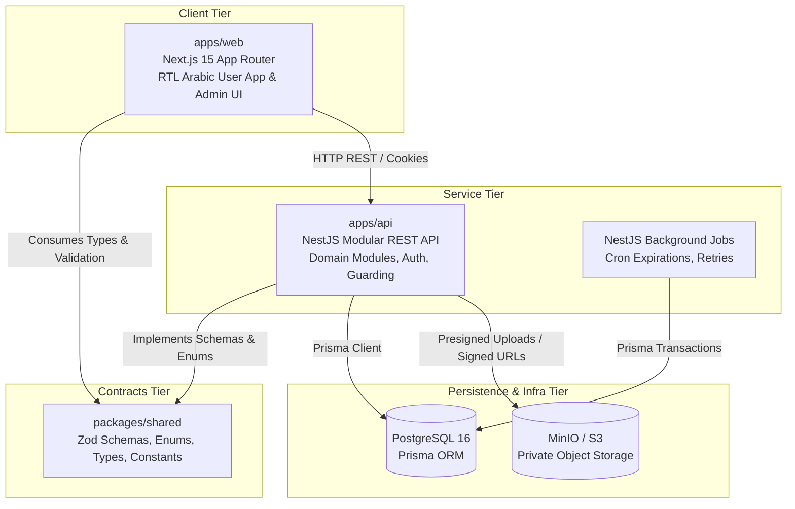
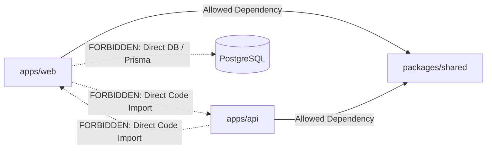

# Architecture Spine — El Masaif (المصايف)

## Design Paradigm

El Masaif implements a **Decoupled Modular Monorepo Architecture** with strict boundary separation between presentation, domain orchestration, and shared contracts:



- **Presentation Layer (`apps/web`):** Next.js 15+ App Router. Purely responsible for rendering UI, state management, RTL Arabic layouts, and interacting with the backend API via standardized HTTP fetch client. **No direct database queries or Next.js Server Action mutations**.
- **Domain API Layer (`apps/api`):** NestJS application with modular architecture (`auth`, `users`, `listings`, `offers`, `deals`, `demands`, `contracts`, `payments`, `admin`, `audit`). Encapsulates all business rules, RBAC permissions, state transition engines, Prisma data access, and background jobs.
- **Shared Contracts (`packages/shared`):** Single source of truth for TypeScript interfaces, Zod validation schemas, business constants (e.g. 2.5% commission rate, 48-hour deal deadline), and domain enums.

---

## Invariants & Rules



### AD-1 — Monorepo Layout and Boundaries
- **Binds:** `all` (entire codebase).
- **Prevents:** Divergence in data validation rules, duplication of types between client and server, and leaky database concerns into web components.
- **Rule:** The repository is organized under npm/pnpm/turborepo workspaces with `apps/web`, `apps/api`, and `packages/shared`. Code imports may flow from `apps/*` into `packages/shared`, but never between `apps/web` and `apps/api`.

### AD-2 — Strict Presentation / Domain Separation
- **Binds:** `apps/web`, `apps/api`.
- **Prevents:** Business rule leaks into frontend components and bypass of audit logs or state validation.
- **Rule:** All state mutations and data reads MUST execute through authenticated NestJS REST endpoints under `/api/v1`. Next.js Server Actions and Route Handlers are prohibited from executing database queries. State transitions strictly map to dedicated action endpoints (`POST /api/v1/deals/:id/cancel`, `POST /api/v1/payments/:id/confirm`).

### AD-3 — Non-Custodial Dual External Bank Transfer Model
- **Binds:** `apps/api/src/modules/deals`, `apps/api/src/modules/payments`, `packages/shared`.
- **Prevents:** Regulatory violation under Saudi financial law (escrow holding without banking license) and intermediary payment fraud.
- **Rule:** The platform NEVER receives, holds, or disburses property purchase prices. A completed Deal consists of two independent external bank transfers:
  1. **Platform Commission (2.5%):** Wired to the platform bank account with generated reference code `ELM-{dealId}-C`.
  2. **Property Sale Price:** Wired directly from Buyer to Seller's verified Saudi IBAN.
  Both payment proofs must be audited and approved by Admin before a deal transitions to `Completed`.

### AD-4 — Prisma Interactive Transactions & Deal Exclusivity Locking
- **Binds:** `apps/api/src/modules/deals`, `apps/api/src/modules/offers`.
- **Prevents:** Double-selling of properties, concurrent conflicting offers reaching approval, and race conditions during payment verification.
- **Rule:** Deal creation (`Final Approval`) and Deal completion MUST run inside Prisma interactive transactions (`$transaction`). The target listing is row-locked (`SELECT ... FOR UPDATE`), and a partial database unique index guarantees that a listing has at most one non-terminal deal (`status NOT IN ('Cancelled', 'Terminated')`).

### AD-5 — Dual-Realm Authentication & Session Management
- **Binds:** `apps/api/src/modules/auth`, `apps/web`.
- **Prevents:** Privilege escalation between regular users and back-office staff, and token theft via client scripts.
- **Rule:** End users (`Buyer`, `Marketer`, `Owner`) and `Admin` staff authenticate into distinct database tables and sessions. Sessions are stored server-side in PostgreSQL and issued via `HttpOnly`, `Secure`, `SameSite=Lax` cookies. Passwords hashed using Argon2id. OTP uses a pluggable `OtpProvider` interface with a static development provider (`123456`) strictly barred from production builds.

### AD-6 — Private S3 Object Storage & Insert-Only Audit Logging
- **Binds:** `apps/api/src/modules/storage`, `apps/api/src/modules/audit`.
- **Prevents:** Unauthorized access to sensitive national IDs, title deeds, and bank receipts; tampering with platform audit history.
- **Rule:** All uploaded documents and receipts are private in S3-compatible storage and accessed exclusively via short-lived signed URLs (<= 15 minutes) issued following an RBAC authorization check. All administrative actions and state transitions write to an immutable, insert-only `AuditLog` table within the same database transaction.

---

## Consistency Conventions

| Concern | Convention | Enforced By |
|---|---|---|
| **API Path & Versioning** | Base path `/api/v1`. Resource-oriented nouns (`/listings`, `/offers`, `/deals`). Explicit action verbs for state changes (`/deals/:id/cancel`). | NestJS Controller routing & Swagger |
| **Data & Field Formats** | CamelCase in JSON payloads; snake_case in PostgreSQL database tables and columns. | Prisma schema mapping (`@map`, `@@map`) |
| **Financial Values** | Money represented as decimal strings (e.g. `'3000000.00'`), never floating-point numbers. Explicit currency code `SAR`. | Zod schemas, Prisma `Decimal(12,2)` |
| **IBAN Validation** | Saudi IBANs must start with `SA`, exactly 24 characters, validated with ISO 7064 mod-97 checksum on client and server. | Shared Zod validator `saudiIbanSchema` |
| **Timestamps** | ISO 8601 UTC strings (`YYYY-MM-DDTHH:mm:ss.sssZ`). Web app formats for Saudi timezone (`Asia/Riyadh`). | Global NestJS serialization interceptor |
| **Error Format** | Standard envelope: `{ statusCode, code, message, details, timestamp, path }`. Stable error codes translated on web. | Global NestJS Exception Filter |
| **Pagination** | `page` (default 1) and `limit` (default 20, max 100). Envelope: `{ data: [], meta: { total, page, limit, totalPages } }`. | Shared pagination DTO |

---

## Stack (Structural Seed)

| Technology | Layer / Package | Version / Fit |
|---|---|---|
| **Node.js** | Runtime | `>= 20.0.0` (Active LTS, verified v22.18.0) |
| **Next.js** | `apps/web` | `15.x` (App Router, React 19, TypeScript) |
| **NestJS** | `apps/api` | `10.x` (Node.js TypeScript framework) |
| **Prisma ORM** | `apps/api` | `5.x` (PostgreSQL client & migrations) |
| **PostgreSQL** | Database | `16.x` (ACID transactions, JSONB, Full-Text Search) |
| **TypeScript** | Universal | `5.x` (Strict mode enabled across all packages) |
| **Tailwind CSS** | `apps/web` | `3.4.x` (Utility-first styling with RTL plugin) |
| **Zod** | `packages/shared` | `3.23.x` (Schema validation & runtime contracts) |
| **Argon2** | `apps/api` | `0.40.x` (Industry-standard password hashing) |
| **Docker Compose** | Local Infra | PostgreSQL 16, MinIO (S3), Mailpit |

---

## Structural Seed

### Monorepo Source Tree

```text
/
├── apps/
│   ├── web/                         # Next.js 15 presentation layer
│   │   ├── src/
│   │   │   ├── app/                 # Next.js App Router (RTL Arabic root)
│   │   │   │   ├── (public)/        # Landing, Search, Property Details, Demands
│   │   │   │   ├── (auth)/          # Login, Register, OTP verification
│   │   │   │   ├── (dashboard)/     # /app/buyer, /app/marketer, /app/owner
│   │   │   │   └── (admin)/         # /admin back-office queues
│   │   │   ├── components/          # Reusable UI & Layout components
│   │   │   ├── lib/                 # API fetch client, formatters, RTL helpers
│   │   │   └── styles/              # globals.css with DESIGN.md tokens
│   │   ├── package.json
│   │   ├── tailwind.config.ts
│   │   └── tsconfig.json
│   │
│   └── api/                         # NestJS REST backend
│       ├── prisma/
│       │   ├── schema.prisma        # Database schema definitions
│       │   └── seed.ts              # Initial roles, admin user, test listings
│       ├── src/
│       │   ├── modules/
│       │   │   ├── auth/            # Dual-realm session auth & OTP provider
│       │   │   ├── users/           # Buyer, Marketer (Fal), Owner profiles
│       │   │   ├── listings/        # Property listing lifecycle & search
│       │   │   ├── offers/          # Offers & counter-offers negotiation
│       │   │   ├── deals/           # Deal state machine & 48h timer
│       │   │   ├── payments/        # Dual bank transfer proofs verification
│       │   │   ├── demands/         # Buyer purchase demands
│       │   │   ├── contracts/       # Owner electronic listing contracts
│       │   │   ├── admin/           # Moderation & compliance queues
│       │   │   ├── audit/           # Immutable audit log service
│       │   │   ├── storage/         # Private S3 upload & signed URL service
│       │   │   └── jobs/            # Postgres queue cron jobs
│       │   ├── common/              # Guards, filters, interceptors, pipes
│       │   ├── prisma/              # PrismaService & PrismaModule
│       │   ├── app.module.ts
│       │   └── main.ts
│       ├── package.json
│       └── tsconfig.json
│
├── packages/
│   └── shared/                      # Shared types, Zod schemas, constants
│       ├── src/
│       │   ├── constants/           # Business limits, fees, deadlines
│       │   ├── enums/               # Statuses, roles, property types
│       │   ├── schemas/             # Zod validation schemas
│       │   ├── types/               # TypeScript interfaces & DTOs
│       │   └── index.ts
│       ├── package.json
│       └── tsconfig.json
│
├── docker-compose.yml               # Local PostgreSQL, MinIO, Mailpit
├── package.json                     # Root workspace configuration
└── tsconfig.base.json
```

---

## Capability → Architecture Map

| Capability / Epic | Lives In | Governed By |
|---|---|---|
| **E0: Platform Foundation & Core Services** | `apps/api/src/modules/audit`, `storage`, `jobs` | `AD-1`, `AD-5`, `AD-6` |
| **E1: Identity, Auth & Saudi Profiles** | `apps/api/src/modules/auth`, `users` | `AD-5`, `saudiIbanSchema` |
| **E2: Property Listings & Moderation** | `apps/api/src/modules/listings`, `admin` | `AD-2`, PostgreSQL FTS |
| **E3: Buyer Search, Map & Demands** | `apps/web/src/app/(public)`, `apps/api/src/modules/demands` | `AD-2`, Bounding box query |
| **E4: Mediated Offers & Negotiation** | `apps/api/src/modules/offers`, `admin` | `AD-2`, Negotiation state machine |
| **E5: Deals & Dual Bank Transfer Verification** | `apps/api/src/modules/deals`, `payments` | `AD-3`, `AD-4`, `AD-6` |
| **E6: Marketer Workspace & Fal Compliance** | `apps/api/src/modules/users`, `jobs` | `AD-5`, Daily compliance cron |
| **E7: Owner Contracts & Electronic Signature** | `apps/api/src/modules/contracts` | `AD-5`, OTP stamping |
| **E8: Admin Operations & Moderation Queues** | `apps/web/src/app/(admin)`, `apps/api/src/modules/admin` | `AD-2`, `AD-5`, `AD-6` |

---

## Deferred Decisions

1. **Production SMS Gateway Provider:** Deferring the final selection of external SMS provider (Unifonic, Taqnyat, or Twilio) to deployment staging; static OTP provider (`123456`) completely satisfies local and test environments.
2. **WebSocket Gateway for Real-time Feeds:** Deferring WebSockets/SSE to post-MVP; short-polling (15–30s) satisfies v1 negotiation notifications with lower infrastructure overhead.
3. **Map Rendering Provider:** Deferring Mapbox vs Google Maps vs OpenStreetMap commercial licensing; Leaflet/Mapbox GL abstraction with standard tile endpoints binds cleanly.
