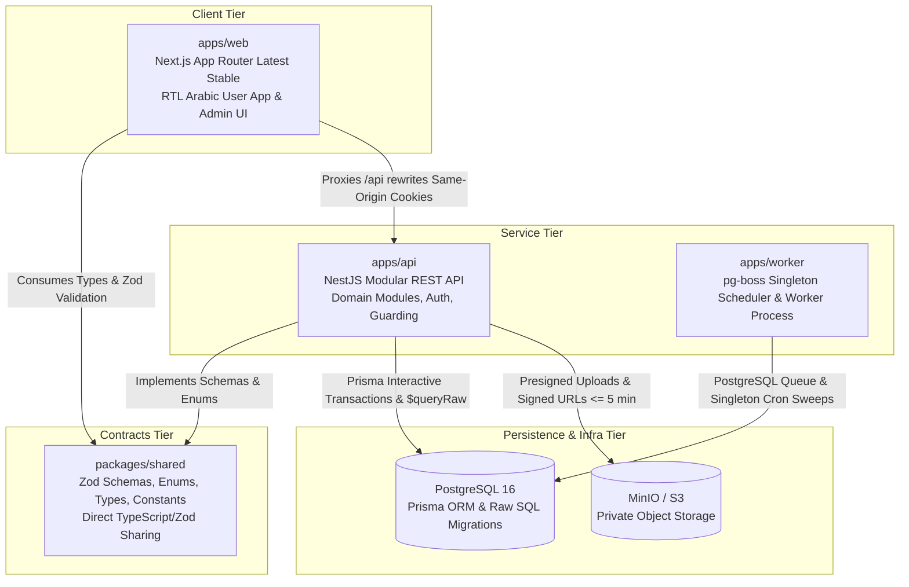
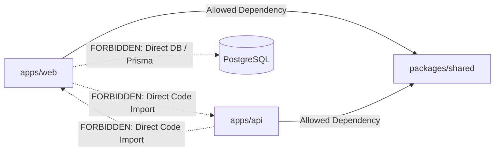

# Architecture Spine — El Masaif (المصايف)

## Design Paradigm

El Masaif implements a **Decoupled Modular Monorepo Architecture** with strict boundary separation between presentation, domain orchestration, and shared contracts:



- **Presentation Layer (`apps/web`):** Next.js App Router (latest stable). Purely responsible for rendering UI, state management, RTL Arabic layouts, and interacting with the backend API via standardized HTTP fetch client. **No direct database queries or Next.js Server Action mutations**. Proxies `/api/*` via Next.js rewrites so session cookies stay same-origin.
- **Domain API Layer (`apps/api`):** NestJS modular application (`auth`, `users`, `listings`, `offers`, `deals`, `demands`, `contracts`, `payments`, `admin`, `audit`, `storage`, `jobs`). Sole owner of business logic, dynamic RBAC permission guards, state transition engines, Prisma data access, and storage integrations. Endpoints live under `/api/v1`.
- **Worker Layer (`apps/worker`):** Standalone worker process running ONE scheduler (`pg-boss` schedule with singleton keys) for recurring background sweeps and queue workers, avoiding multiple scheduler cron execution across API instances.
- **Shared Contracts (`packages/shared`):** Single source of truth for TypeScript interfaces, Zod validation schemas, business constants, and domain enums. Shared directly across client and server without generated OpenAPI client overhead in MVP.

---

## Invariants & Rules



### AD-1 — Monorepo Layout, Same-Origin API Proxy & Boundaries
- **Binds:** `all` (entire codebase).
- **Prevents:** Divergence in data validation rules, duplication of types between client and server, cross-origin cookie / third-party cookie blocking issues, and leaky database concerns into web components.
- **Rule:** The repository is organized under npm workspaces with `apps/web`, `apps/api`, `apps/worker`, and `packages/shared`. Code imports may flow from `apps/*` into `packages/shared`, but never between `apps/web` and `apps/api`. `apps/web` runs Next.js App Router (pinned to latest stable at implementation; verified during scaffolding). To ensure session authentication cookies stay strictly same-origin and avoid third-party cookie restrictions, `apps/web` proxies all `/api/*` requests through Next.js rewrites (`next.config.js`) directly to the backend NestJS service (`apps/api`).

### AD-2 — Strict Presentation / Domain Separation & Explicit Action Endpoints
- **Binds:** `apps/web`, `apps/api`.
- **Prevents:** Business rule leaks into frontend components, unauthorized direct state mutations, and bypass of audit logs or state validation.
- **Rule:** All state mutations and data reads MUST execute through authenticated NestJS REST endpoints under `/api/v1`. Next.js Server Actions and Route Handlers are prohibited from executing database queries. Generic `PATCH /entities/:id` status updates (e.g. `PATCH /deals/:id` with `{ status: "..." }`) are strictly forbidden. State transitions MUST execute via explicit semantic action endpoints:
  - `POST /api/v1/deals/:id/cancel-by-buyer`
  - `POST /api/v1/deals/:id/dispute`
  - `POST /api/v1/admin/deals/:id/final-approve`
  - `POST /api/v1/admin/payments/:id/confirm`
  - `POST /api/v1/admin/payments/:id/reject`

### AD-3 — Non-Custodial Dual Bank Transfer, Snapshotted Settlement & Protected Payment Deadlines
- **Binds:** `apps/api/src/modules/deals`, `apps/api/src/modules/payments`, `apps/worker`, `packages/shared`.
- **Prevents:** Regulatory violation under Saudi financial law (escrow custody without banking license), retroactive fee manipulation, in-flight seller IBAN tampering, unfair deal cancellations during active administrative review, and stranded transactions when counterparties dispute.
- **Rule:** The platform NEVER receives, holds, or disburses property purchase prices. A completed Deal consists of two independent external bank transfers:
  1. **Platform Commission:** Calculated dynamically as `(property_price * commission_rate_percentage) + fixed_fee_amount`. Both parameters are read from system settings (`UC-76`) and immutably snapshotted onto the `Deal` record at final approval (`UC-70B`). Wired to the platform bank account with generated reference code `ELM-{dealId}-C`.
  2. **Property Sale Price:** Wired directly from Buyer to Seller's verified payout account (`account_holder_name` and Saudi `iban`), which MUST be immutably snapshotted onto the `Deal` record at final approval (`UC-70B`) to prevent in-flight IBAN alteration.
  
  **Payment Timing, Deadline & Timeout Protection Engine:**
  - **Upload Deadline:** `PaymentDeadline = Deal.createdAt + PaymentWindowHours` (system setting, default 48 hours). It is the deadline for **uploading** proofs, NOT for confirmation.
  - **Expiry at Deadline:** At `PaymentDeadline`, each payment record still without an uploaded proof automatically transitions to `Expired`.
  - **On-Time Proof Protection:** A payment proof uploaded before `PaymentDeadline` is protected. The background timeout cron (`payment-deadline-expiry`) NEVER cancels a Deal while any payment is in status `ProofUploaded` or `UnderReview`.
  - **Rejection & Correction Window:**
    - A proof rejected *before* the deadline can be re-uploaded freely until `PaymentDeadline`.
    - A proof rejected *at or after* `PaymentDeadline` receives exactly one correction window of `PaymentCorrectionHours` (system setting, default 12 hours) calculated from the rejection timestamp (`ClockService.now() + PaymentCorrectionHours`). If no replacement proof arrives by the end of this correction window, that payment transitions to `Expired`.
  - **Post-Deadline Outcome Evaluation:** Outcome is evaluated whenever a payment changes state after the deadline, and ONLY when no payment is `ProofUploaded`, `UnderReview`, or inside an active correction window:
    - *Both Confirmed:* Deal atomically transitions to `Completed`.
    - *Price Confirmed, Commission Expired:* Deal transitions to `Disputed` and requires a Super Admin decision (`Deals.DisputeResolve`; never auto-cancelled).
    - *Commission Confirmed, Price Expired:* Deal transitions to `CancelledByTimeout`, unconfirmed price payment is set to `Expired`, and the case is flagged for Super Admin (per OQ-13 commission refund review).
    - *Both Expired:* Deal transitions to `CancelledByTimeout`, both payments are set to `Expired`, and the Listing reverts to `Active`.
  - **Review SLA Tiers (24/7 Calendar):**
    - Tier 1 (4h unreviewed): `payment.sla_alert_4h` internal alert dispatched to Support Admins.
    - Tier 2 (12h unreviewed): `payment.sla_escalation_12h` escalation alert dispatched to Super Admin.
    - Tier 3 (24h unreviewed): `payment.sla_mandatory_decision_24h` mandatory decision required from Super Admin (strictly limited to Confirm or Reject with reason; NEVER cancels the Deal).
  - **Fraud Log Event Trigger:** Repeated rejected proofs trigger automated compliance fraud events (`FR-62`) using settings `FraudRejectedProofThreshold` (default 3) within `FraudWindowHours` (default 72).
  - **Dispute Freeze:** A `Disputed` Deal is NEVER auto-cancelled; the timeout cron completely ignores it. A Super Admin decision is strictly one of: Complete the deal (`Completed`), Cancel the deal (`CancelledByAdmin`), or Return to review (`PaymentUnderReview`) with a new explicit deadline and documented reason.

### AD-4 — Interactive Transaction Locking ($queryRaw) & DB Exclusivity Constraints
- **Binds:** `apps/api/src/modules/deals`, `apps/api/src/modules/offers`, `apps/api/prisma`.
- **Prevents:** Double-selling of properties, concurrent conflicting offers reaching approval, race conditions during payment verification, and invalid negative financial states.
- **Rule:** Deal creation (`Final Approval`), Deal completion, and payment approval MUST run inside Prisma interactive transactions (`prisma.$transaction(async (tx) => { ... })`). Because Prisma Client does not provide native row-level locking, row locking on target listings MUST be executed via `tx.$queryRaw` using `SELECT ... FROM "Listing" WHERE "id" = $1 FOR UPDATE`. Database-level exclusivity and integrity constraints MUST be established in a dedicated raw SQL migration:
  1. A partial unique index guaranteeing at most one active, non-terminal deal per listing:
     ```sql
     CREATE UNIQUE INDEX deal_single_active ON "Deal" ("listing_id")
     WHERE status NOT IN ('Completed', 'CancelledByBuyer', 'CancelledBySeller', 'CancelledByTimeout', 'CancelledByAdmin');
     ```
  2. Explicit `CHECK` constraints on financial columns ensuring non-negative amounts, valid fee rates, and positive listing prices.

### AD-5 — Dual-Realm Authentication, Hard Production OTP Guard & Account Lifecycle
- **Binds:** `apps/api/src/modules/auth`, `apps/api/src/modules/users`, `apps/web`.
- **Prevents:** Privilege escalation between regular users and back-office staff, token theft via client scripts, account takeover, orphaned sessions during recovery, and catastrophic security bypass via development credentials in production.
- **Rule:** End users (`Buyer`, `Marketer`, `Owner`) and `Admin` staff authenticate into distinct database tables and sessions. Sessions are stored server-side in PostgreSQL and issued via `HttpOnly`, `Secure`, `SameSite=Lax` cookies. Passwords hashed using Argon2id. OTP uses a pluggable `OtpProvider` interface with a static development provider (`123456`) for local testing.
  - **Hard Production Guard:** A mandatory NestJS bootstrap lifecycle check (`OnApplicationBootstrap`) actively inspects active provider configuration: if `NODE_ENV === 'production'` and the static OTP provider is enabled or active, the application MUST immediately throw a fatal error and abort startup (`process.exit(1)`).
  - **Legal Consent Tracking:** Registration (`FR-1`) atomically logs an insert-only `ConsentRecord` (`termsVersion`, `privacyVersion`, `consentTimestamp`, `ipAddress`, `userAgent`, `source`) without default values for Saudi PDPL audit compliance. Publishing a new terms or privacy version triggers a blocking re-consent screen upon next login.
  - **Account Lifecycle & Deletion Guardrails (`FR-2`, `FR-43`, `FR-50`):**
    - `DeletionPending`: Self-service deletion request places accounts with zero transaction history into `DeletionPending` with a 14-day cooling-off window. Authenticating while in `DeletionPending` immediately cancels the deletion request and restores the account to `Active`.
    - `Deactivated`: Accounts with transaction history (listings, offers, deals, payments, contracts, messages, ratings, reports, or tickets) are placed into `Deactivated` status upon deletion request; underlying records are preserved per Saudi commercial and tax retention mandates.
    - Login Refusal: Accounts in `Deactivated`, `Disabled`, or `SoftDeleted` status are strictly refused login with explicit error codes (`AUTH_ACCOUNT_DEACTIVATED`, `AUTH_ACCOUNT_DISABLED`).
    - Administrative Password Reset (`FR-70`): Super Admin can initiate password recovery via a single-use email link expiring in 15 minutes (`Rbac.Manage`). Direct temporary passwords are prohibited. Action revokes all active admin sessions and logs to `AuditLog`.
    - Phone Change Management (`FR-48`, `R-09`): Dual-OTP verification on old and new Saudi numbers within 15 minutes. Support-assisted path requires permission `Users.PhoneChange`, restricted exclusively to Super Admin by default.

### AD-6 — S3 Object Storage (In-Kingdom Residency), Quarantine Malware Scanning & Insert-Only Audit
- **Binds:** `apps/api/src/modules/storage`, `apps/api/src/modules/audit`, `apps/api/src/modules/admin`.
- **Prevents:** Data residency violations under Saudi PDPL/REGA laws, storage of infected malware binaries, unauthorized access to sensitive national IDs, and tampering with audit logs or customer reviews.
- **Rule:**
  - **Data Residency (AR2, AR7, NFR2, OQ-12):** Storage and database must be hosted in a region inside the Kingdom of Saudi Arabia (the AWS Saudi region, announced for December 2026, or an in-Kingdom provider). me-south-1 (Bahrain) may be used only as an interim, only after written legal sign-off on cross-border processing under PDPL, with a documented migration plan. Region and endpoints are configuration-only (`STORAGE_REGION`, `STORAGE_ENDPOINT`, `DATABASE_URL`). Production launch is blocked until OQ-12 is closed by legal counsel. Direct public URLs are prohibited; downloads occur strictly via short-lived signed URLs (<= 5 minutes) issued following an RBAC authorization check (max 10MB, PDF/images).
  - **Malware Scanning Quarantine Hook (NFR13):** Uploaded binaries are written to an isolated quarantine location prior to automated scanning. File records track scan status via `FileObject.scanStatus` (`Pending`, `Clean`, `Infected`, `ScanFailed`) and `scannedAt`. Only files with status `Clean` are moved to final storage; if the scanner service is unavailable, the system fails CLOSED and non-Clean files are never served.
  - **Insert-Only Audit Logging:** All administrative actions, state transitions, consent events, and payout account edits write to an immutable, insert-only `AuditLog` table within the same database transaction.
  - **Review Moderation (`Reviews.Moderate`, `FR-52`):** Public reviews can be hidden by authorized admins (`isHidden = true`, `hiddenByAdminId`, `hiddenAt`, `hiddenReason`) to eliminate defamation; the original review content and admin moderation rationale are permanently captured in `AuditLog` (rows are never deleted).
  - **ZATCA E-Invoicing Phase 2 Structural Readiness (`AR14`, `FR-68`):** MVP stores invoice data (`InvoiceRecord`: sequence numbers, confirmed commission and contract fee amounts, buyer/seller identifiers, VAT rate default 15%, calculated VAT) so Phase 2 needs no data rework; clearance and stamping are added later in InvoicingModule.

### AD-7 — Separate Worker Process (pg-boss Scheduler) & Idempotent Background Job Catalog
- **Binds:** `apps/worker`, `apps/api/src/modules/jobs`, `apps/api/src/modules/deals`, `apps/api/src/modules/audit`.
- **Prevents:** Lost asynchronous tasks on server reboot, job duplication, distributed scheduler collisions, API thread pool exhaustion, and un-audited background state shifts.
- **Rule:** Background queues and recurring scheduling run via ONE dedicated scheduler (`pg-boss` schedule with singleton keys) executed in a separate worker process (`apps/worker`), not in every API instance. Recurring scheduled jobs (@nestjs/schedule cron) are removed from API instances. Every job handler MUST be strictly idempotent (safe to retry multiple times without duplicate side effects). Any asynchronous state transition executed by background jobs MUST write to the immutable `AuditLog` table within the same database transaction.
  
  **Canonical Background Job Catalog:**
  1. `payment-deadline-expiry` (Cadence: Every 60s): Scans Deals where `now() >= PaymentDeadline`. Evaluates protected states, active correction windows, and post-deadline outcome matrix. Transitions unconfirmed payments lacking proofs to `Expired`. Dispatches cancellation alerts and reverts listings to `Active`.
  2. `offer-expiry-checker` (Cadence: Every 5m): Scans Offers where `now() >= OfferExpiry`. Sets expired offers to `Expired` and emits notifications.
  3. `demand-expiry-checker` (Cadence: Hourly): Scans Demands where `now() >= ExpiresAt`. Sets expired demands to `Expired` and closes unaccepted proposals.
  4. `fal-license-expiry` (Cadence: Daily at 00:05 UTC): Scans approved Fal profiles where `expiryDate <= today()`. Moves profile to `ComplianceRestricted`, transitions active listings to `UnderComplianceReview`, and emits fraud/compliance alerts.
  5. `fal-expiry-warnings` (Cadence: Daily at 08:00 KSA): Scans profiles expiring in 30, 7, and 1 days; dispatches urgent renewal alerts via in-app and email.
  6. `owner-fee-reminders` (Cadence: Daily): Scans contracts in `SignedPendingFee` nearing `ContractFeeDeadline` (7 days); dispatches payment reminder alerts.
  7. `notification-retention` (Cadence: Daily): Scans notifications older than 90 days; hard deletes records to optimize table size.

### AD-8 — Explicit Action Endpoints, Idempotency Keys & Optimistic Concurrency Control
- **Binds:** `apps/api`, `apps/web`, `packages/shared`.
- **Prevents:** Unintended partial status mutations via generic PATCH calls, duplicate payment proof submissions or double-approval decisions from network retries, conflicting concurrent administrative approvals, and untracked API client errors.
- **Rule:**
  1. **Explicit Semantic Action Endpoints:** Generic PATCH updates on status fields (`PATCH /deals/:id` with `{ status: '...' }`) are strictly forbidden. All entity lifecycle transitions must hit dedicated POST action endpoints.
  2. **Standard Error Envelope:** Global NestJS exception filter enforces the error envelope: `{ code: string, message: string, details?: Record<string, any>, requestId: string }`.
  3. **Idempotency Keys:** Mutating requests involving financial transactions, proof uploads, final approval submissions, and admin approval/rejection decisions MUST include an `Idempotency-Key` HTTP header. The backend tracks key status in PostgreSQL to guarantee exactly-once processing during client retries.
  4. **Optimistic Concurrency Control:** Entities subject to concurrent multi-party modification (Deals, Offers, Listings) maintain an integer `version` field. Mutation endpoints require the client to supply `If-Match: "<version>"`. If the database version differs, the API returns `409 Conflict`.

### AD-9 — Master Data Geography (City & District Cascading Models & Composite Keys)
- **Binds:** `apps/api/prisma`, `apps/api/src/modules/listings`, `apps/api/src/modules/demands`, `packages/shared`.
- **Prevents:** Inaccurate demand matching, misspelled location filters, and fragmented geographic search queries resulting from unstructured free-text inputs.
- **Rule:** Geographic data is modeled via dedicated master tables `City` and `District` with one-to-many cascading relationships. `District` enforces `isActive: Boolean` and `@@unique([id, cityId])`. `Listing` binds via composite foreign key `[districtId, cityId] -> District[id, cityId]`. `City` also enforces `isActive: Boolean`. Property listings (`Listing`) and Buyer demands (`Demand`) MUST bind to `city_id` and optional `district_id` as foreign keys. Unvalidated free-text city/district submissions are rejected at the API boundary via Zod schema validation.

### AD-10 — Operational Queue Task Claim Locking & Concurrency Control
- **Binds:** `apps/api/src/modules/admin`, `apps/api/src/modules/listings`, `apps/api/src/modules/payments`, `apps/api/src/modules/deals`, `apps/web`.
- **Prevents:** Concurrent dual-processing by multiple administrators, collision of moderation decisions, and conflicting actions on sensitive payment proofs and disputes.
- **Rule:** All operational admin queues enforce task claim locking:
  - Claim is an explicit `POST /api/v1/admin/<queue>/<id>/claim`, never a GET request or passive page view.
  - Executed via an atomic conditional SQL `UPDATE`:
    ```sql
    UPDATE target_table
    SET locked_by_admin_id = $adminId,
        locked_at = ClockService.now(),
        lock_expires_at = ClockService.now() + INTERVAL '15 minutes'
    WHERE id = $id
      AND (locked_by_admin_id IS NULL OR lock_expires_at < ClockService.now());
    ```
  - Client heartbeat renews every 5 minutes; lock is released on decision commit or when explicitly unclaiming/leaving.
  - Other inspecting administrators view the item in read-only mode with a banner: "being handled by {adminName}".
  - Permission `Tasks.ForceUnlock` allows Super Admin to forcibly release any lock with a mandatory documented reason (audited in `AuditLog`).
  - A task claim NEVER replaces the version / `If-Match` check; stale decision submissions return `409 Conflict`.
  - Applies to all 8 operational queues: `Listing`, `FalProfile`, `OwnerListingRequest`, `Payment` (each payment audited individually, NOT PaymentProof), `ContractFeePayment`, `Conversation`, `Dispute`, and `Offer`.
  - **Separation of Duties (`FR-51`):** The administrator verifying a payment proof CANNOT execute final deal approval on that same transaction.

### AD-11 — Deterministic Time Simulation (Injectable ClockService)
- **Binds:** `apps/api/src/modules/common`, `apps/api/src/modules/deals`, `apps/api/src/modules/jobs`.
- **Prevents:** Flaky integration tests, untestable payment timeout scenarios, and inability to simulate multi-day lifecycle events (48h deal window, 12h correction windows, 30d/7d/1d Fal license expirations) in staging and QA environments.
- **Rule:** Direct calls to `new Date()` or `Date.now()` within domain services and background jobs are strictly prohibited. All temporal calculations and deadlines MUST route through `ClockService.now()`, and clock timestamps must be passed directly into database queries. In production (`NODE_ENV=production`), virtual clock manipulation endpoints are strictly refused via an application startup check. In testing and staging environments, `ClockService` supports virtual clock shifting (`clockService.advanceTimeBy(hours)`), enabling instantaneous, deterministic verification of the payment deadline, correction window extensions, and scheduled sweeps.

### AD-12 — Granular Dynamic RBAC, Administrative Permission Matrix & Separation of Duties
- **Binds:** `apps/api/src/modules/admin`, `apps/api/src/modules/auth`, `apps/web`.
- **Prevents:** Administrative privilege creep, unauthorized back-office operations, accidental financial overrides, and insider collusion during deal verification.
- **Rule:** All administrative actions are governed by dynamic Role-Based Access Control enforcing granular permissions formatted as `Area.Action`. Every back-office controller endpoint enforces permission decorators (`@RequirePermissions('Deals.FinalApprove')`) validated via NestJS global authorization guards. System seeds two primary administrative roles: `Super Admin` (all permissions) and `Support Team` (operational review permissions).
  - **Separation of Duties (`FR-40`, `FR-51`, `R-12`):** An administrator who confirms or rejects a payment proof on a Deal is hard-blocked by backend domain guards from executing `Deals.FinalApprove` on that same deal.
  - **Super Admin Guarded Privileges:** High-risk actions (`Users.Status`, `Users.HardDelete`, `Users.PhoneChange`, `Deals.FinalApprove`, `Deals.DisputeResolve`, `Tasks.ForceUnlock`, `Settings.Commission`, `Settings.Manage`, `Rbac.Manage`) are restricted exclusively to Super Admin by default.
  - **Audit Logging:** Every administrative action, whether granted or rejected, writes an immutable, append-only record to `AuditLog`.

---

## State Machine Transition Tables

### 1. Deal State Machine Transitions

| Initial State | Target State | Triggering Action / Event | Actor |
|---|---|---|---|
| *(none)* | `AwaitingPaymentProof` | Final deal approval granted (`UC-70B`) | Admin (`Deals.FinalApprove`) |
| `AwaitingPaymentProof` | `PaymentUnderReview` | First payment proof uploaded (`UC-28`) | Buyer |
| `PaymentUnderReview` | `AwaitingPaymentProof` | Proof rejected and no other proof currently pending | System / Admin |
| `AwaitingPaymentProof` | `CancelledByBuyer` | Buyer cancels deal prior to uploading any proof (`UC-29B`) | Buyer |
| `AwaitingPaymentProof` | `CancelledBySeller` | Seller cancellation approved prior to proof upload (`UC-46`) | Admin |
| `AwaitingPaymentProof` / `PaymentUnderReview` | `CancelledByTimeout` | 48-hour deadline passed without on-time pending review (`UC-29A`) | System Scheduler |
| `PaymentUnderReview` | `Completed` | Both payments (Commission & Price) Confirmed (`UC-29`) | System (via Admin UC-71) |
| `PaymentUnderReview` | `Disputed` | Dispute filed after proof upload (`UC-29C`) or Price Confirmed + Commission Expired | Buyer / Seller / System |
| `Disputed` | `PaymentUnderReview` | Admin returns dispute to review queue (`UC-70C`) | Admin (`Deals.DisputeResolve`) |
| `Disputed` | `Completed` | Admin settles dispute by confirming completion (`UC-70C`) | Admin (`Deals.DisputeResolve`) |
| `Disputed` | `CancelledByAdmin` | Admin settles dispute by cancelling deal (`UC-70C`) | Admin (`Deals.DisputeResolve`) |

*Note: Terminal states are `Completed`, `CancelledByBuyer`, `CancelledBySeller`, `CancelledByTimeout`, and `CancelledByAdmin`.*

### 2. Dual Payment State Machine Transitions (Commission & Price)

| Initial State | Target State | Triggering Action / Event | Actor |
|---|---|---|---|
| `Pending` | `ProofUploaded` | Buyer uploads wire transfer receipt (`UC-28`) | Buyer |
| `ProofUploaded` | `UnderReview` | Admin opens proof in review queue | Admin (`Payments.Review`) |
| `ProofUploaded` / `UnderReview` | `Confirmed` | Admin verifies and approves proof (`UC-71`) | Admin (`Payments.Review`) |
| `ProofUploaded` / `UnderReview` | `Rejected` | Admin rejects proof with mandatory reason (`UC-71`) | Admin (`Payments.Review`) |
| `Rejected` | `ProofUploaded` | Buyer re-uploads replacement proof before deadline or within correction window | Buyer |
| `Pending` / `ProofUploaded` / `Rejected` | `Expired` | Deal cancels or times out (`UC-29A`) | System Scheduler |

### 3. Property Listing State Machine Transitions

| Initial State | Target State | Triggering Action / Event | Actor |
|---|---|---|---|
| `Draft` | `Submitted` | Creator submits listing for review (`UC-34`) | Marketer / Owner |
| `Submitted` | `UnderReview` | Listing enters admin moderation queue | System |
| `UnderReview` | `Active` | Admin approves listing (`UC-63`) | Admin (`Listings.Review`) |
| `UnderReview` | `Rejected` | Admin rejects listing with notes | Admin (`Listings.Review`) |
| `Active` | `Reserved` | Deal created via Final Approval (`UC-70B`) | Admin (`Deals.FinalApprove`) |
| `Reserved` | `Sold` | Deal atomically completes (`UC-29`) | System |
| `Reserved` | `Active` | Deal cancelled or times out (`UC-29A`, `UC-29B`) | System |
| `Active` | `UnderReview` | Major edit made (ask price, location, type) | Marketer / Owner |
| `Active` | `Archived` | Creator archives listing (no active deal) (`UC-39`) | Marketer / Owner |
| `Active` / `Reserved` | `Hidden` | Admin hides listing for non-compliance (`UC-66`) | Admin (`Listings.Compliance`) |
| `Active` / `Reserved` | `Blocked` | Admin blocks listing permanently (`UC-66`) | Admin (`Listings.Compliance`) |
| `Active` | `UnderComplianceReview` | Marketer Fal license expires (`UC-43`) | System Scheduler |
| `UnderComplianceReview` | `Active` | Marketer Fal renewal approved (`UC-43`) | Admin (`Licenses.Review`) |

### 4. Owner Listing Contract State Machine Transitions

| Initial State | Target State | Triggering Action / Event | Actor |
|---|---|---|---|
| *(none)* | `Draft` | Owner submits listing request (`UC-50`) | Owner |
| `Draft` | `Submitted` | Request routed to admin | Owner |
| `Submitted` | `ApprovedPendingSignature` | Admin selects template and sets fee (`UC-67`) | Admin (`Contracts.Review`) |
| `ApprovedPendingSignature` | `SignedPendingFee` | Owner signs electronically via OTP (`UC-53`) | Owner |
| `SignedPendingFee` | `FeeUnderReview` | Owner uploads contract fee bank proof (`UC-55`) | Owner |
| `FeeUnderReview` | `Active` | Admin confirms fee proof; listing published (`UC-68A`) | Admin (`ContractFees.Review`) |
| `FeeUnderReview` | `FeeRejected` | Admin rejects proof with reason; re-upload allowed | Admin (`ContractFees.Review`) |
| `SignedPendingFee` | `Expired` | 7-day payment window expires without proof | System Scheduler |
| `Active` | `Completed` | Underlying listing deal completes (`UC-29`) | System |

### 5. Fal License Profile State Machine Transitions

| Initial State | Target State | Triggering Action / Event | Actor |
|---|---|---|---|
| *(none)* | `Draft` | Marketer begins onboarding | Marketer |
| `Draft` | `Submitted` / `UnderReview`| Marketer submits certificate and CR (`UC-04`) | Marketer |
| `UnderReview` | `Approved` | Admin validates certificate (`UC-62`) | Admin (`Licenses.Review`) |
| `UnderReview` | `Rejected` | Admin rejects with documented reason | Admin (`Licenses.Review`) |
| `Rejected` | `Resubmitted` / `UnderReview`| Marketer corrects details and re-submits (`UC-05A`)| Marketer |
| `Approved` | `ComplianceRestricted` | License expiry date reached without renewal | System Scheduler |
| `ComplianceRestricted` | `RenewalUnderReview` | Marketer submits renewed certificate (`UC-43`) | Marketer |
| `RenewalUnderReview` | `Approved` | Admin approves renewal (`UC-62`) | Admin (`Licenses.Review`) |

---

## Consistency Conventions

| Concern | Convention | Enforced By |
|---|---|---|
| **API Path & Versioning** | Base path `/api/v1`. Resource-oriented nouns (`/listings`, `/offers`, `/deals`). Explicit action verbs for state changes (`/deals/:id/cancel-by-buyer`). | NestJS Controller routing & Swagger |
| **Data & Field Formats** | CamelCase in JSON payloads; snake_case in PostgreSQL database tables and columns. | Prisma schema mapping (`@map`, `@@map`) |
| **Financial Values** | Money represented as decimal strings (e.g. `'3000000.00'`), never floating-point numbers. Explicit currency code `SAR`. | Zod schemas, Prisma `Decimal(12,2)` |
| **Commission Formula** | Dynamic: `(price * rate_percent) + fixed_fee`. Snapshotted on `Deal` at approval (`UC-70B`). | Deal creation transaction & Zod schema |
| **IBAN Validation** | Saudi IBANs must start with `SA`, exactly 24 characters, validated with ISO 7064 mod-97 checksum on client and server. | Shared Zod validator `saudiIbanSchema` |
| **Geography** | Structured `cityId` and `districtId` referencing master tables with `isActive` flags and composite FK. Free text rejected. | Master `City`/`District` models & Zod |
| **Queue Task Locking** | Explicit claim `POST /claim`, 15-minute lease via `lockedByAdminId`, `lockedAt`, `lockExpiresAt` with 5-minute heartbeat. Read-only banner for other admins. Super Admin `Tasks.ForceUnlock`. | Admin module interceptors & DB queries |
| **Timestamps** | ISO 8601 UTC strings (`YYYY-MM-DDTHH:mm:ss.sssZ`). Web app formats for Saudi timezone (`Asia/Riyadh`). | Global NestJS serialization interceptor |
| **Time Evaluation** | All domain time operations routed through injectable `ClockService.now()`. Passed directly into database queries. | Common `ClockService` & startup guard |
| **Error Format** | Standard envelope: `{ code, message, details, requestId }`. Stable error codes translated on web. | Global NestJS Exception Filter |
| **Pagination** | `page` (default 1) and `limit` (default 20, max 100). Envelope: `{ data: [], meta: { total, page, limit, totalPages } }`. | Shared pagination DTO |
| **Real-Time Updates** | Short polling (15–30s interval) for active negotiations, deal countdowns, and moderation queues in MVP. SSE deferred post-MVP. | Web client hook & NestJS cache-control |
| **Client Contracts** | Direct consumption of shared TypeScript types and Zod schemas from `packages/shared`. No generated OpenAPI client in MVP. | TypeScript project references / npm workspaces |

---

## Stack (Structural Seed)

| Technology | Layer / Package | Version / Fit |
|---|---|---|
| **Node.js** | Runtime | `>= 20.0.0` (Active LTS, verified v22.18.0) |
| **Next.js** | `apps/web` | `latest stable` (App Router, React 19, TypeScript) |
| **NestJS** | `apps/api` | `10.x` (Node.js TypeScript framework) |
| **pg-boss** | `apps/worker` | `10.x` (ONE scheduler with singleton keys in worker process) |
| **Prisma ORM** | `apps/api` | `5.x` (PostgreSQL client & migrations) |
| **PostgreSQL** | Database | `16.x` (ACID transactions, JSONB, Full-Text Search) |
| **Cloud Storage** | Object Storage | Region inside KSA (AWS Saudi Dec 2026 / in-Kingdom provider); me-south-1 (Bahrain) interim only with legal sign-off on cross-border processing outside the Kingdom under PDPL / MinIO (Local) |
| **TypeScript** | Universal | `5.x` (Strict mode enabled across all packages) |
| **Tailwind CSS** | `apps/web` | `3.4.x` (Utility-first styling with RTL plugin) |
| **Zod** | `packages/shared` | `3.23.x` (Schema validation & runtime contracts) |
| **Argon2** | `apps/api` | `0.40.x` (Industry-standard password hashing) |
| **Docker Compose** | Local Infra | PostgreSQL 16, MinIO (S3), Mailpit |

---

## Structural Seed

### Monorepo Source Tree

```text
/
├── apps/
│   ├── web/                         # Next.js presentation layer (latest stable)
│   │   ├── next.config.ts           # /api/* rewrites to NestJS backend
│   │   ├── src/
│   │   │   ├── app/                 # Next.js App Router (RTL Arabic root)
│   │   │   │   ├── (public)/        # Landing, Search, Property Details, Demands
│   │   │   │   ├── (auth)/          # Login, Register, OTP verification
│   │   │   │   ├── (dashboard)/     # /app/buyer, /app/marketer, /app/owner
│   │   │   │   └── (admin)/         # /admin back-office queues
│   │   │   ├── components/          # Reusable UI & Layout components
│   │   │   ├── lib/                 # API fetch client, formatters, RTL helpers
│   │   │   └── styles/              # globals.css with DESIGN.md tokens
│   │   ├── package.json
│   │   ├── tailwind.config.ts
│   │   └── tsconfig.json
│   │
│   ├── api/                         # NestJS REST backend
│   │   ├── prisma/
│   │   │   ├── schema.prisma        # Database schema definitions
│   │   │   ├── migrations/          # Raw SQL migrations (partial indexes, CHECK constraints)
│   │   │   └── seed.ts              # Initial roles, admin user, test listings
│   │   ├── src/
│   │   │   ├── modules/
│   │   │   │   ├── auth/            # Dual-realm session auth, hard production OTP guard
│   │   │   │   ├── users/           # Buyer, Marketer (Fal), Owner profiles, ConsentRecord
│   │   │   │   ├── listings/        # Property listing lifecycle & search
│   │   │   │   ├── offers/          # Offers & counter-offers negotiation
│   │   │   │   ├── deals/           # Deal state machine, 48h timer, dispute suspension
│   │   │   │   ├── payments/        # Dual bank transfer proofs verification
│   │   │   │   ├── demands/         # Buyer purchase demands
│   │   │   │   ├── contracts/       # Owner electronic listing contracts
│   │   │   │   ├── admin/           # Moderation, task locking & dynamic RBAC
│   │   │   │   ├── audit/           # Immutable audit log service
│   │   │   │   ├── storage/         # Private S3 upload & signed URL service
│   │   │   │   └── jobs/            # Queue triggers & pg-boss enqueuing
│   │   │   ├── common/              # Guards, filters, interceptors, pipes, idempotency
│   │   │   ├── prisma/              # PrismaService & PrismaModule
│   │   │   ├── app.module.ts
│   │   │   └── main.ts
│   │   ├── package.json
│   │   └── tsconfig.json
│   │
│   └── worker/                      # Standalone background worker process
│       ├── src/
│       │   ├── jobs/                # 7 cataloged pg-boss job handlers
│       │   │   ├── payment-deadline-expiry.job.ts
│       │   │   ├── offer-expiry-checker.job.ts
│       │   │   ├── demand-expiry-checker.job.ts
│       │   │   ├── fal-license-expiry.job.ts
│       │   │   ├── fal-expiry-warnings.job.ts
│       │   │   ├── owner-fee-reminders.job.ts
│       │   │   └── notification-retention.job.ts
│       │   ├── worker.module.ts
│       │   └── main.ts
│       ├── package.json
│       └── tsconfig.json
│
├── packages/
│   └── shared/                      # Shared types, Zod schemas, constants (no OpenAPI client)
│       ├── src/
│       │   ├── constants/           # Business limits, fees, deadlines
│       │   ├── enums/               # Statuses, roles, property types, permissions
│       │   ├── schemas/             # Zod validation schemas
│       │   ├── types/               # TypeScript interfaces & DTOs
│       │   └── index.ts
│       ├── package.json
│       └── tsconfig.json
│
├── docker-compose.yml               # Local PostgreSQL, MinIO, Mailpit
├── package.json                     # Root workspace configuration
└── tsconfig.base.json
```

---

## Admin Permission Matrix (`Area.Action`)

The back-office enforces 32 granular permissions mapped to administrative roles:

| Permission Key | Description | Default Support Team | Super Admin |
|---|---|:---:|:---:|
| `Users.View` | View accounts, profiles, sessions, and activity logs | Yes | Yes |
| `Users.Status` | Disable, enable, or soft-delete user accounts | No | Yes |
| `Users.HardDelete` | Hard delete account with zero transactional history | No | Yes |
| `Licenses.Review` | Review, approve, or reject Fal license submissions | Yes | Yes |
| `Listings.Review` | Approve, reject, or request changes on property listings | Yes | Yes |
| `Listings.Compliance` | Hide or block listings for regulatory non-compliance | No | Yes |
| `Price.Suggest` | Send official price change suggestions to sellers | Yes | Yes |
| `Contracts.Review` | Review owner listing requests and generate contracts | Yes | Yes |
| `Contracts.FeeOverride`| Override default owner listing contract fee | No | Yes |
| `ContractFees.Review` | Confirm or reject owner contract fee bank proofs | Yes | Yes |
| `Offers.Review` | Content moderation of buyer offers and proposals | Yes | Yes |
| `Deals.View` | View deal pipeline, timelines, and payment proofs | Yes | Yes |
| `Deals.FinalApprove` | Execute final deal approval and activate payment window | No | Yes |
| `Deals.StatusOverride` | Manual deal status override with mandatory reason | No | Yes |
| `Deals.DisputeResolve` | Adjudicate deal disputes and issue binding verdicts | No | Yes |
| `Payments.Review` | Confirm or reject commission and price payment proofs | Yes | Yes |
| `Conversations.Handle` | Review, moderate, and relay mediated inquiry messages | Yes | Yes |
| `Tickets.Handle` | Manage technical support tickets and SLA timers | Yes | Yes |
| `Reports.Handle` | Adjudicate user and listing violation reports | Yes | Yes |
| `Penalties.Apply` | Issue user penalties, broker fines, or account freezes | No | Yes |
| `Fraud.View` | Monitor fraud logs, IBAN changes, and bypass signals | No | Yes |
| `Finance.View` | Access financial analytics, revenue, and commission logs | No | Yes |
| `Settings.Commission` | Modify platform commission rates and fixed fee settings | No | Yes |
| `Settings.Manage` | Configure operational timeouts, file limits, and policies | No | Yes |
| `Rbac.Manage` | Manage administrative roles, permissions, and staff accounts | No | Yes |
| `Content.Manage` | Manage static CMS pages, marketing banners, and FAQ items | No | Yes |
| `Reports.Analytics` | Generate exportable business and operational reports | No | Yes |
| `Bulk.Execute` | Execute batch operations across listings or queues | No | Yes |
| `Notes.Manage` | Create and view internal administrative notes on entities | Yes | Yes |
| `Audit.View` | Inspect immutable system audit logs | No | Yes |
| `Reviews.Moderate` | Moderate buyer-seller ratings and reviews | Yes | Yes |
| `Geo.Manage` | Manage administrative geographic master data: regions, cities, districts | No | Yes |
| `Tasks.ForceUnlock` | Forcibly release active task claim leases with mandatory reason | No | Yes |
| `Users.PhoneChange` | Administrative phone number re-binding with verified proof | No | Yes |
| `Contracts.Manage` | Manage standard owner contract templates and legal clauses | No | Yes |
| `Compliance.Manage` | Administer regulatory compliance, fraud logs, and numeric penalties | No | Yes |
| `Finance.Export` | Export PDF and Excel financial reports and reconciliation data | No | Yes |
| `CMS.Manage` | Author and publish public CMS content, TOS, privacy policy, and FAQ | No | Yes |

---

## Notification Event Catalog

Standardized event keys dispatched across channels (In-App feed is P0 MVP; Email transport is P1; SMS is P0 for auth/security):

| Event Key | Channel | Recipient | Trigger / Payload Summary |
|---|---|---|---|
| `deal.created` | In-App, Email | Buyer, Seller | Deal created; payment instructions, frozen IBAN, and deadline dispatched |
| `deal.payment_deadline_warning` | In-App, Email | Buyer | Approaching PaymentDeadline warnings (12h, 2h before deadline) |
| `deal.payment_under_review` | In-App | Buyer, Seller | Buyer uploaded payment proof; review initiated |
| `deal.proof_rejected` | In-App, Email | Buyer | Payment proof rejected with admin reason; re-upload instructions |
| `deal.completed` | In-App, Email | Buyer, Seller | Both payments confirmed; counterparty contact details disclosed |
| `deal.timeout_cancelled` | In-App, Email | Buyer, Seller | Deal cancelled due to expired payment deadline without on-time proof |
| `deal.disputed` | In-App, Email | Buyer, Seller, Admin | Dispute initiated; automated cancellation suspended pending Super Admin review |
| `payment.sla_alert_4h` | Internal In-App | Support Admins | Proof unreviewed 4 hours after upload; SLA tier 1 alert |
| `payment.sla_escalation_12h` | Internal In-App | Super Admin | Proof unreviewed 12 hours after upload; SLA tier 2 escalation |
| `payment.sla_mandatory_decision_24h` | Internal In-App | Super Admin | Proof unreviewed 24 hours after upload; mandatory Confirm/Reject decision required |
| `listing.submitted` | In-App | Creator | Listing submitted and queued for moderation |
| `listing.approved` | In-App | Creator | Listing approved to Active marketplace status |
| `listing.rejected` | In-App | Creator | Listing rejected with admin modification notes |
| `listing.major_edit_review` | In-App | Creator | Ask price, location, or type edit reverted listing to UnderReview |
| `contract.ready_for_signature` | In-App, Email | Owner | Listing contract template assigned; signature canvas + OTP ready |
| `contract.signed_pending_fee` | In-App | Owner | Contract signed; 7-day fee payment window active |
| `contract.fee_confirmed` | In-App | Owner | Contract fee verified; listing published to Active |
| `contract.fee_expired` | In-App | Owner | Contract fee payment deadline passed; contract expired |
| `fal.expiry_warning` | In-App, Email | Marketer | Expiration warning dispatched at 30, 7, and 1 day(s) before Fal expiry |
| `fal.expired_restricted` | In-App, Email | Marketer | License expired; profile restricted and active listings suspended |
| `demand.matched` | In-App | Providers | New qualifying buyer demand matched to active provider inventory |
| `demand.proposal_received` | In-App | Buyer | Provider proposal approved and ready for buyer review |
| `support.ticket_sla_alert` | Internal In-App | Support Admins | Support ticket nearing first response (4h) or resolution (2d) SLA |
| `auth.security_alert` | In-App, SMS | Account Owner | New device login, password reset, or OTP step-up failure |
| `auth.policy_reconsent_required` | In-App | User | Blocking re-consent screen triggered on terms or privacy policy update |

---

## Capability → Architecture Map

| Capability / Epic | Lives In | Governed By |
|---|---|---|
| **E0: Platform Foundation & Core Services** | `apps/api/src/modules/audit`, `storage`, `jobs`, `common`, `apps/worker` | `AD-1`, `AD-5`, `AD-6`, `AD-7`, `AD-11` |
| **E1: Identity, Auth & Saudi Profiles** | `apps/api/src/modules/auth`, `users` | `AD-5`, `AD-12`, `saudiIbanSchema`, `ConsentRecord` |
| **E2: Property Listings & Moderation** | `apps/api/src/modules/listings`, `admin` | `AD-2`, `AD-8`, `AD-9`, `AD-10`, PostgreSQL FTS |
| **E3: Buyer Search, Map & Demands** | `apps/web/src/app/(public)`, `apps/api/src/modules/demands` | `AD-1`, `AD-2`, `AD-9`, Bounding box query |
| **E4: Mediated Offers & Negotiation** | `apps/api/src/modules/offers`, `admin` | `AD-2`, `AD-8`, `AD-10`, Short polling (15-30s) |
| **E5: Deals & Dual Bank Transfer Verification** | `apps/api/src/modules/deals`, `payments`, `apps/worker` | `AD-3`, `AD-4`, `AD-6`, `AD-7`, `AD-8`, `AD-10`, `AD-11` |
| **E6: Marketer Workspace & Fal Compliance** | `apps/api/src/modules/users`, `jobs`, `apps/worker` | `AD-5`, `AD-7`, `AD-10`, Daily compliance cron |
| **E7: Owner Contracts & Electronic Signature** | `apps/api/src/modules/contracts`, `apps/worker` | `AD-5`, `AD-8`, `AD-10`, OTP stamping |
| **E8: Admin Operations & Moderation Queues** | `apps/web/src/app/(admin)`, `apps/api/src/modules/admin` | `AD-2`, `AD-5`, `AD-6`, `AD-8`, `AD-10`, `AD-12` |

---

## Data Architecture & Prisma Schema Specifications

The canonical database schema is maintained in `apps/api/prisma/schema.prisma`. All domain models strictly follow the corrected requirements below:

### 1. User, Account & Legal Consent (`ConsentRecord`)
- **No Default Values for Consent:** Consent columns are removed from `User`. An insert-only `ConsentRecord` model records each legal agreement (`termsVersion`, `privacyVersion`, `consentTimestamp`, `ipAddress`, `userAgent`, `source`).
- **Account State Machine & Deletion (`FR-50`):** `User` includes `deletionRequestedAt`, `deletionDueAt` (14-day cooling-off), `pendingEmail`, `emailVerifiedAt`, and `status = DeletionPending`. Users without historical transactions are hard erased/anonymized after cooling-off; users with transaction records are placed in `Deactivated` status and retained per legal counsel retention schedules.
- **Phone Change Management (`FR-48`):** `PhoneChangeRequest` tracks dual-OTP verification (both old and new number within 15 minutes) and support-assisted changes (`Users.PhoneChange` permission, mandatory identity audit).

### 2. Geographic Master Data (`District`, `City`) & Composite Keys
- **City & District Management (`FR-53`):** `City` and `District` both include `isActive` flags to support deactivation without breaking existing references.
- **Composite Uniqueness & Referential Integrity:** `District` declares `@@unique([id, cityId])`. `Listing` enforces geographic validity via composite foreign key `[districtId, cityId]` referencing `District[id, cityId]`. Free text entry for city/district is strictly prohibited.

### 3. Distributed Admin Task Claim & Locking (`FR-51`)
- **Entities Subject to Admin Claim Locking:**
  1. `Listing` (`lockedByAdminId`, `lockedAt`, `lockExpiresAt`, `@@index([lockExpiresAt])`)
  2. `FalProfile` (`lockedByAdminId`, `lockedAt`, `lockExpiresAt`, `@@index([lockExpiresAt])`)
  3. `OwnerListingRequest` (`lockedByAdminId`, `lockedAt`, `lockExpiresAt`, `@@index([lockExpiresAt])`)
  4. `Payment` (each payment separately, `lockedByAdminId`, `lockedAt`, `lockExpiresAt`, `@@index([lockExpiresAt])`)
  5. `ContractFeePayment` (`lockedByAdminId`, `lockedAt`, `lockExpiresAt`, `@@index([lockExpiresAt])`)
  6. `Conversation` (`lockedByAdminId`, `lockedAt`, `lockExpiresAt`, `@@index([lockExpiresAt])`)
  7. `Dispute` (`lockedByAdminId`, `lockedAt`, `lockExpiresAt`, `@@index([lockExpiresAt])`)
  8. `Offer` (`lockedByAdminId`, `lockedAt`, `lockExpiresAt`, `@@index([lockExpiresAt])`)
- **Lock Removal:** Locks are explicitly **removed** from `PaymentProof` and `Deal`. Each `Payment` record is claimed and audited individually.
- **Protocol:** Explicit `POST /api/v1/admin/<queue>/<id>/claim`, 15-minute lease, 5-minute heartbeat renewal, optimistic concurrency `If-Match` / `version` checks retained.

### 4. Malware Quarantine & Storage (`FileObject`, `PropertyDocument`)
- **Quarantine Pipeline (`NFR13`):** All uploaded files land in an isolated quarantine bucket. `FileObject` / `PropertyDocument` track `scanStatus` (`Pending`, `Clean`, `Infected`, `ScanFailed`) and `scannedAt`.
- **Fail Closed:** Only files marked `Clean` are moved to final storage and served via 5-minute presigned URLs. Non-clean files return HTTP 403 Forbidden.

### 5. Review Moderation (`Rating`)
- **Review Controls (`FR-52`, `FR-54`):** `Rating` includes `isHidden` (default `false`), `hiddenByAdminId`, `hiddenAt`, and `hiddenReason`. Hidden ratings are excluded from calculated averages and counts. Physical database rows are never deleted.

### 6. Invoicing & VAT Data Capture (`InvoiceRecord`)
- **Financial Record Capture (`FR-68`, `AR14`):** `InvoiceRecord` stores sequence numbers, confirmed commission and contract fee amounts, buyer/seller identifiers, VAT rate (default 15%), and tax treatment snapshots. No claim of ZATCA compliance in MVP; data foundation is preserved for Phase 2 clearance and stamping.

---

## Deferred Decisions

1. **Production SMS Gateway Provider:** Deferring the final selection of external SMS provider (Unifonic, Taqnyat, or Twilio) to deployment staging; static OTP provider with mandatory production guard supports local and test environments safely.
2. **Map Rendering Provider:** Deferring Mapbox vs Google Maps vs OpenStreetMap commercial licensing; Leaflet/Mapbox GL abstraction with standard tile endpoints binds cleanly.
