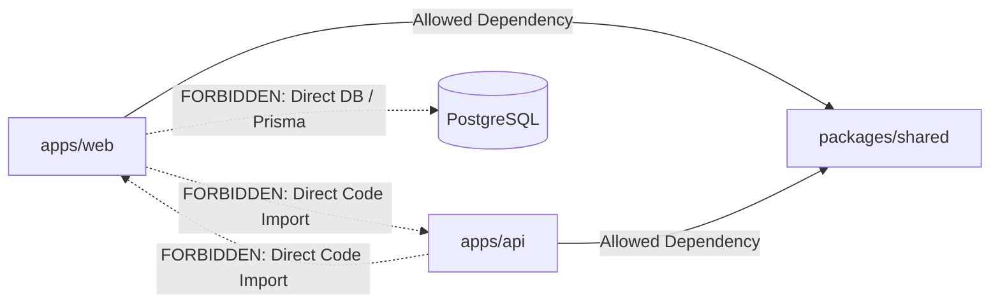

# Architecture Spine — El Masaif (المصايف)

## Design Paradigm

El Masaif implements a **Decoupled Modular Monorepo Architecture** with strict boundary separation between presentation, domain orchestration, and shared contracts:

```mermaid
graph TD
    subgraph Client Tier
        W[apps/web<br/>Next.js App Router (Latest Stable)<br/>RTL Arabic User App & Admin UI]
    end

    subgraph Contracts Tier
        S[packages/shared<br/>Zod Schemas, Enums, Types, Constants<br/>Direct TypeScript/Zod Sharing]
    end

    subgraph Service Tier
        A[apps/api<br/>NestJS Modular REST API<br/>Domain Modules, Auth, Guarding]
        J[apps/api Embedded Jobs<br/>pg-boss & @nestjs/schedule Cron]
    end

    subgraph Persistence & Infra Tier
        DB[(PostgreSQL 16<br/>Prisma ORM & Raw SQL Migrations)]
        S3[(MinIO / S3<br/>Private Object Storage)]
    end

    W -->|Consumes Types & Zod Validation| S
    A -->|Implements Schemas & Enums| S
    W -->|Proxies /api rewrites (Same-Origin Cookies)| A
    A -->|Prisma Interactive Transactions & $queryRaw| DB
    J -->|PostgreSQL Queue & Cron Sweeps| DB
    A -->|Presigned Uploads & Signed URLs| S3
```

- **Presentation Layer (`apps/web`):** Next.js App Router (latest stable). Purely responsible for rendering UI, state management, RTL Arabic layouts, and interacting with the backend API via standardized HTTP fetch client. **No direct database queries or Next.js Server Action mutations**. Proxies `/api/*` via Next.js rewrites so session cookies stay same-origin.
- **Domain API Layer (`apps/api`):** NestJS application with modular architecture (`auth`, `users`, `listings`, `offers`, `deals`, `demands`, `contracts`, `payments`, `admin`, `audit`, `jobs`, `storage`). Encapsulates all business rules, RBAC permissions, state transition engines, Prisma data access, background pg-boss jobs, and cron tasks.
- **Shared Contracts (`packages/shared`):** Single source of truth for TypeScript interfaces, Zod validation schemas, business constants, and domain enums. Shared directly without generated OpenAPI client overhead in MVP.

---

## Invariants & Rules



### AD-1 — Monorepo Layout, Same-Origin API Proxy & Boundaries
- **Binds:** `all` (entire codebase).
- **Prevents:** Divergence in data validation rules, duplication of types between client and server, cross-origin cookie / third-party cookie blocking issues, and leaky database concerns into web components.
- **Rule:** The repository is organized under npm workspaces with `apps/web`, `apps/api`, and `packages/shared`. Code imports may flow from `apps/*` into `packages/shared`, but never between `apps/web` and `apps/api`. `apps/web` runs Next.js App Router (pinned to latest stable at implementation; verified during scaffolding). To ensure session authentication cookies stay strictly same-origin and avoid third-party cookie restrictions, `apps/web` proxies all `/api/*` requests through Next.js rewrites (`next.config.js`) directly to the backend NestJS service (`apps/api`).

### AD-2 — Strict Presentation / Domain Separation
- **Binds:** `apps/web`, `apps/api`.
- **Prevents:** Business rule leaks into frontend components and bypass of audit logs or state validation.
- **Rule:** All state mutations and data reads MUST execute through authenticated NestJS REST endpoints under `/api/v1`. Next.js Server Actions and Route Handlers are prohibited from executing database queries. State transitions strictly map to dedicated action endpoints (`POST /api/v1/deals/:id/cancel`, `POST /api/v1/payments/:id/confirm-commission`).

### AD-3 — Non-Custodial Dual Bank Transfer & Snapshotted Financial Settlement
- **Binds:** `apps/api/src/modules/deals`, `apps/api/src/modules/payments`, `packages/shared`.
- **Prevents:** Regulatory violation under Saudi financial law (escrow holding without banking license), retroactive commission changes, in-flight seller IBAN tampering, and indefinitely stalled transactions.
- **Rule:** The platform NEVER receives, holds, or disburses property purchase prices. A completed Deal consists of two independent external bank transfers:
  1. **Platform Commission:** Calculated dynamically as `(property_price * commission_rate_percentage) + fixed_fee_amount`. Both parameters are read from system settings (`UC-76`) and immutably snapshotted onto the `Deal` record at final approval (`UC-70B`). Wired to the platform bank account with generated reference code `ELM-{dealId}-C`.
  2. **Property Sale Price:** Wired directly from Buyer to Seller's verified payout account (`account_holder_name` and Saudi `iban`), which MUST be immutably snapshotted onto the `Deal` record at final approval (`UC-70B`) to prevent in-flight IBAN alteration.
  Both payment proofs must be audited and approved by Admin before a deal transitions to `Completed`.
  **Payment Deadline:** A configurable payment deadline (default 48 hours, configured in system settings) is activated upon deal approval. An automated background job (`AD-7`) sweeps expired deals and transitions unfulfilled deals to `Expired`. Opening an official dispute immediately suspends the payment timer until administrative resolution.

### AD-4 — Interactive Transaction Locking ($queryRaw) & DB Constraints
- **Binds:** `apps/api/src/modules/deals`, `apps/api/src/modules/offers`, `apps/api/prisma`.
- **Prevents:** Double-selling of properties, concurrent conflicting offers reaching approval, race conditions during payment verification, and invalid negative financial states.
- **Rule:** Deal creation (`Final Approval`), Deal completion, and payment approval MUST run inside Prisma interactive transactions (`prisma.$transaction(async (tx) => { ... })`). Because Prisma Client does not provide native row-level locking, row locking on target listings MUST be executed via `tx.$queryRaw` using `SELECT ... FROM "Listing" WHERE "id" = $1 FOR UPDATE`. Database-level exclusivity and integrity constraints MUST be established in a dedicated raw SQL migration:
  1. A partial unique index guaranteeing at most one active, non-terminal deal per listing (`CREATE UNIQUE INDEX deal_single_active_per_listing ON "Deal" ("listing_id") WHERE status NOT IN ('Cancelled', 'Terminated', 'Expired')`).
  2. Explicit `CHECK` constraints on financial columns ensuring non-negative amounts, valid fee rates, and positive listing prices.

### AD-5 — Dual-Realm Authentication & Hard Production OTP Guard
- **Binds:** `apps/api/src/modules/auth`, `apps/web`.
- **Prevents:** Privilege escalation between regular users and back-office staff, token theft via client scripts, and catastrophic security bypass via development bypass credentials in production.
- **Rule:** End users (`Buyer`, `Marketer`, `Owner`) and `Admin` staff authenticate into distinct database tables and sessions. Sessions are stored server-side in PostgreSQL and issued via `HttpOnly`, `Secure`, `SameSite=Lax` cookies. Passwords hashed using Argon2id. OTP uses a pluggable `OtpProvider` interface with a static development provider (`123456`) for local testing.
  **Hard Production Guard:** A mandatory NestJS bootstrap lifecycle check (`OnApplicationBootstrap`) actively inspects active provider configuration: if `NODE_ENV === 'production'` and the static OTP provider is enabled or active, the application MUST immediately throw a fatal error and abort startup (`process.exit(1)`), preventing deployment with test authentication enabled.

### AD-6 — Private S3 Object Storage & Insert-Only Audit Logging
- **Binds:** `apps/api/src/modules/storage`, `apps/api/src/modules/audit`.
- **Prevents:** Unauthorized access to sensitive national IDs, title deeds, and bank receipts; tampering with platform audit history.
- **Rule:** All uploaded documents and receipts are private in S3-compatible storage and accessed exclusively via short-lived signed URLs (<= 15 minutes) issued following an RBAC authorization check (max 10MB, PDF/images). All administrative actions and state transitions write to an immutable, insert-only `AuditLog` table within the same database transaction.

### AD-7 — Embedded PostgreSQL Queue (pg-boss) & Idempotent Background Jobs
- **Binds:** `apps/api/src/modules/jobs`, `apps/api/src/modules/deals`, `apps/api/src/modules/audit`.
- **Prevents:** Lost asynchronous tasks on server reboot, job duplication, distributed architecture overhead (e.g. separate Redis clusters or standalone worker fleets) during MVP, and un-audited background state shifts.
- **Rule:** Background queues run via `pg-boss` embedded directly inside the `apps/api` Node.js process, utilizing the existing PostgreSQL database for job persistence, retries, and locks. Recurring scheduled operations (cron) use `@nestjs/schedule` (e.g. daily Fal compliance status checks, deal expiration sweeps). Every job handler MUST be strictly idempotent (safe to retry multiple times without duplicate side effects). Any asynchronous state transition executed by background jobs (such as deal expiration timeout) MUST write to the immutable `AuditLog` table within the same database transaction. Separating job processing into a dedicated standalone worker process/container is explicitly deferred until system scale requires independent horizontal scaling.

### AD-8 — Explicit Action Endpoints, Idempotency & Optimistic Locking
- **Binds:** `apps/api`, `apps/web`, `packages/shared`.
- **Prevents:** Unintended partial status mutations via generic PATCH calls, duplicate payment proof submissions or double-approval decisions from network retries, conflicting concurrent administrative approvals, and untracked API client errors.
- **Rule:**
  1. **Explicit Semantic Action Endpoints:** Generic PATCH updates on status fields (`PATCH /deals/:id` with `{ status: '...' }`) are strictly forbidden. All entity lifecycle transitions must hit dedicated POST action endpoints (`POST /api/v1/deals/:id/approve`, `POST /api/v1/deals/:id/cancel`, `POST /api/v1/deals/:id/dispute`, `POST /api/v1/payments/:id/confirm-commission`, `POST /api/v1/payments/:id/confirm-purchase-price`).
  2. **Standard Error Envelope:** Global NestJS exception filter enforces the error envelope: `{ code: string, message: string, details?: Record<string, any>, requestId: string }`.
  3. **Idempotency Keys:** Mutating requests involving financial transactions, proof uploads, final approval submissions, and admin approval/rejection decisions MUST include an `Idempotency-Key` HTTP header. The backend tracks key status in PostgreSQL to guarantee exactly-once processing during client retries.
  4. **Optimistic Concurrency Control:** Entities subject to concurrent multi-party modification (Deals, Offers, Listings) maintain an integer `version` field. Mutation endpoints require the client to supply `If-Match: "<version>"`. If the database version differs, the API returns `409 Conflict`.

---

## Consistency Conventions

| Concern | Convention | Enforced By |
|---|---|---|
| **API Path & Versioning** | Base path `/api/v1`. Resource-oriented nouns (`/listings`, `/offers`, `/deals`). Explicit action verbs for state changes (`/deals/:id/cancel`). | NestJS Controller routing & Swagger |
| **Data & Field Formats** | CamelCase in JSON payloads; snake_case in PostgreSQL database tables and columns. | Prisma schema mapping (`@map`, `@@map`) |
| **Financial Values** | Money represented as decimal strings (e.g. `'3000000.00'`), never floating-point numbers. Explicit currency code `SAR`. | Zod schemas, Prisma `Decimal(12,2)` |
| **Commission Formula** | Dynamic: `(price * rate_percent) + fixed_fee`. Snapshotted on `Deal` at approval (`UC-70B`). | Deal creation transaction & Zod schema |
| **IBAN Validation** | Saudi IBANs must start with `SA`, exactly 24 characters, validated with ISO 7064 mod-97 checksum on client and server. | Shared Zod validator `saudiIbanSchema` |
| **Timestamps** | ISO 8601 UTC strings (`YYYY-MM-DDTHH:mm:ss.sssZ`). Web app formats for Saudi timezone (`Asia/Riyadh`). | Global NestJS serialization interceptor |
| **Error Format** | Standard envelope: `{ code, message, details, requestId }`. Stable error codes translated on web. | Global NestJS Exception Filter |
| **Pagination** | `page` (default 1) and `limit` (default 20, max 100). Envelope: `{ data: [], meta: { total, page, limit, totalPages } }`. | Shared pagination DTO |
| **Real-Time Updates** | Short polling (15–30s interval) for active negotiations, deal countdowns, and moderation queues in MVP. SSE deferred post-MVP. | Web client hook & NestJS cache-control |
| **Client Contracts** | Direct consumption of shared TypeScript types and Zod schemas from `packages/shared`. No generated OpenAPI client in MVP. | TypeScript project references / npm workspaces |

---

## Stack (Structural Seed)

| Technology | Layer / Package | Version / Fit |
|---|---|---|
| **Node.js** | Runtime | `>= 20.0.0` (Active LTS, verified v22.18.0) |
| **Next.js** | `apps/web` | `latest stable` (App Router, React 19, TypeScript) |
| **NestJS** | `apps/api` | `10.x` (Node.js TypeScript framework) |
| **pg-boss** | `apps/api` | `10.x` (PostgreSQL job queue for background jobs) |
| **@nestjs/schedule** | `apps/api` | `4.x` (Cron jobs & scheduled tasks) |
| **Prisma ORM** | `apps/api` | `5.x` (PostgreSQL client & migrations) |
| **PostgreSQL** | Database | `16.x` (ACID transactions, JSONB, Full-Text Search) |
| **TypeScript** | Universal | `5.x` (Strict mode enabled across all packages) |
| **Tailwind CSS** | `apps/web` | `3.4.x` (Utility-first styling with RTL plugin) |
| **Zod** | `packages/shared` | `3.23.x` (Schema validation & runtime contracts) |
| **Argon2** | `apps/api` | `0.40.x` (Industry-standard password hashing) |
| **Docker Compose** | Local Infra | PostgreSQL 16, MinIO (S3), Mailpit |

---

## Structural Seed

### Monorepo Source Tree

```text
/
├── apps/
│   ├── web/                         # Next.js presentation layer (latest stable)
│   │   ├── next.config.ts           # /api/* rewrites to NestJS backend
│   │   ├── src/
│   │   │   ├── app/                 # Next.js App Router (RTL Arabic root)
│   │   │   │   ├── (public)/        # Landing, Search, Property Details, Demands
│   │   │   │   ├── (auth)/          # Login, Register, OTP verification
│   │   │   │   ├── (dashboard)/     # /app/buyer, /app/marketer, /app/owner
│   │   │   │   └── (admin)/         # /admin back-office queues
│   │   │   ├── components/          # Reusable UI & Layout components
│   │   │   ├── lib/                 # API fetch client, formatters, RTL helpers
│   │   │   └── styles/              # globals.css with DESIGN.md tokens
│   │   ├── package.json
│   │   ├── tailwind.config.ts
│   │   └── tsconfig.json
│   │
│   └── api/                         # NestJS REST backend
│       ├── prisma/
│       │   ├── schema.prisma        # Database schema definitions
│       │   ├── migrations/          # Raw SQL migrations (partial indexes, CHECK constraints)
│       │   └── seed.ts              # Initial roles, admin user, test listings
│       ├── src/
│       │   ├── modules/
│       │   │   ├── auth/            # Dual-realm session auth, hard production OTP guard
│       │   │   ├── users/           # Buyer, Marketer (Fal), Owner profiles
│       │   │   ├── listings/        # Property listing lifecycle & search
│       │   │   ├── offers/          # Offers & counter-offers negotiation
│       │   │   ├── deals/           # Deal state machine, 48h timer, dispute suspension
│       │   │   ├── payments/        # Dual bank transfer proofs verification
│       │   │   ├── demands/         # Buyer purchase demands
│       │   │   ├── contracts/       # Owner electronic listing contracts
│       │   │   ├── admin/           # Moderation & compliance queues
│       │   │   ├── audit/           # Immutable audit log service
│       │   │   ├── storage/         # Private S3 upload & signed URL service
│       │   │   └── jobs/            # pg-boss queue runner & @nestjs/schedule cron
│       │   ├── common/              # Guards, filters, interceptors, pipes, idempotency
│       │   ├── prisma/              # PrismaService & PrismaModule
│       │   ├── app.module.ts
│       │   └── main.ts
│       ├── package.json
│       └── tsconfig.json
│
├── packages/
│   └── shared/                      # Shared types, Zod schemas, constants (no OpenAPI client)
│       ├── src/
│       │   ├── constants/           # Business limits, fees, deadlines
│       │   ├── enums/               # Statuses, roles, property types
│       │   ├── schemas/             # Zod validation schemas
│       │   ├── types/               # TypeScript interfaces & DTOs
│       │   └── index.ts
│       ├── package.json
│       └── tsconfig.json
│
├── docker-compose.yml               # Local PostgreSQL, MinIO, Mailpit
├── package.json                     # Root workspace configuration
└── tsconfig.base.json
```

---

## Capability → Architecture Map

| Capability / Epic | Lives In | Governed By |
|---|---|---|
| **E0: Platform Foundation & Core Services** | `apps/api/src/modules/audit`, `storage`, `jobs` | `AD-1`, `AD-5`, `AD-6`, `AD-7` |
| **E1: Identity, Auth & Saudi Profiles** | `apps/api/src/modules/auth`, `users` | `AD-5`, `saudiIbanSchema` |
| **E2: Property Listings & Moderation** | `apps/api/src/modules/listings`, `admin` | `AD-2`, `AD-8`, PostgreSQL FTS |
| **E3: Buyer Search, Map & Demands** | `apps/web/src/app/(public)`, `apps/api/src/modules/demands` | `AD-1`, `AD-2`, Bounding box query |
| **E4: Mediated Offers & Negotiation** | `apps/api/src/modules/offers`, `admin` | `AD-2`, `AD-8`, Short polling (15-30s) |
| **E5: Deals & Dual Bank Transfer Verification** | `apps/api/src/modules/deals`, `payments` | `AD-3`, `AD-4`, `AD-6`, `AD-7`, `AD-8` |
| **E6: Marketer Workspace & Fal Compliance** | `apps/api/src/modules/users`, `jobs` | `AD-5`, `AD-7`, Daily compliance cron |
| **E7: Owner Contracts & Electronic Signature** | `apps/api/src/modules/contracts` | `AD-5`, `AD-8`, OTP stamping |
| **E8: Admin Operations & Moderation Queues** | `apps/web/src/app/(admin)`, `apps/api/src/modules/admin` | `AD-2`, `AD-5`, `AD-6`, `AD-8` |

---

## Deferred Decisions

1. **Production SMS Gateway Provider:** Deferring the final selection of external SMS provider (Unifonic, Taqnyat, or Twilio) to deployment staging; static OTP provider with mandatory production guard satisfies local and test environments safely.
2. **Map Rendering Provider:** Deferring Mapbox vs Google Maps vs OpenStreetMap commercial licensing; Leaflet/Mapbox GL abstraction with standard tile endpoints binds cleanly.
