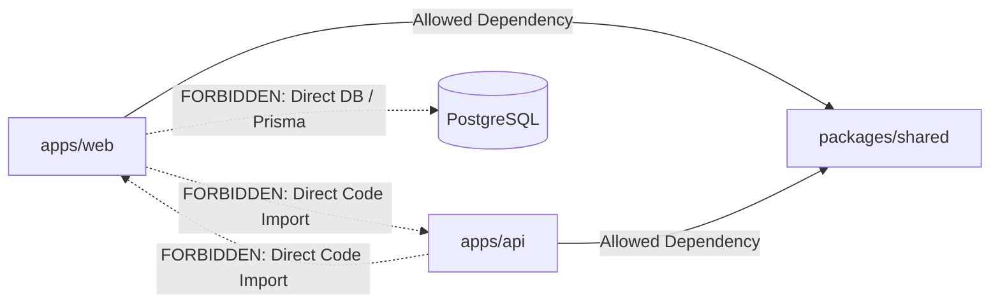

# Architecture Spine — El Masaif (المصايف)

## Design Paradigm

El Masaif implements a **Decoupled Modular Monorepo Architecture** with strict boundary separation between presentation, domain orchestration, and shared contracts:

```mermaid
graph TD
    subgraph Client Tier
        W[apps/web<br/>Next.js App Router (Latest Stable)<br/>RTL Arabic User App & Admin UI]
    end

    subgraph Contracts Tier
        S[packages/shared<br/>Zod Schemas, Enums, Types, Constants<br/>Direct TypeScript/Zod Sharing]
    end

    subgraph Service Tier
        A[apps/api<br/>NestJS Modular REST API<br/>Domain Modules, Auth, Guarding]
        J[apps/worker<br/>pg-boss Singleton Scheduler & Worker Process]
    end

    subgraph Persistence & Infra Tier
        DB[(PostgreSQL 16<br/>Prisma ORM & Raw SQL Migrations)]
        S3[(MinIO / S3<br/>Private Object Storage)]
    end

    W -->|Consumes Types & Zod Validation| S
    A -->|Implements Schemas & Enums| S
    W -->|Proxies /api rewrites (Same-Origin Cookies)| A
    A -->|Prisma Interactive Transactions & $queryRaw| DB
    J -->|PostgreSQL Queue & Singleton Cron Sweeps| DB
    A -->|Presigned Uploads & Signed URLs <= 5 min| S3
```

- **Presentation Layer (`apps/web`):** Next.js App Router (latest stable). Purely responsible for rendering UI, state management, RTL Arabic layouts, and interacting with the backend API via standardized HTTP fetch client. **No direct database queries or Next.js Server Action mutations**. Proxies `/api/*` via Next.js rewrites so session cookies stay same-origin.
- **Domain API Layer (`apps/api`):** NestJS application with modular architecture (`auth`, `users`, `listings`, `offers`, `deals`, `demands`, `contracts`, `payments`, `admin`, `audit`, `jobs`, `storage`). Encapsulates all business rules, RBAC permissions, state transition engines, Prisma data access, and storage integrations.
- **Worker Layer (`apps/worker`):** Standalone worker process running ONE scheduler (`pg-boss` schedule with singleton keys) for recurring background sweeps and queue workers, avoiding multiple scheduler cron execution across API instances.
- **Shared Contracts (`packages/shared`):** Single source of truth for TypeScript interfaces, Zod validation schemas, business constants, and domain enums. Shared directly without generated OpenAPI client overhead in MVP.

---

## Invariants & Rules



### AD-1 — Monorepo Layout, Same-Origin API Proxy & Boundaries
- **Binds:** `all` (entire codebase).
- **Prevents:** Divergence in data validation rules, duplication of types between client and server, cross-origin cookie / third-party cookie blocking issues, and leaky database concerns into web components.
- **Rule:** The repository is organized under npm workspaces with `apps/web`, `apps/api`, `apps/worker`, and `packages/shared`. Code imports may flow from `apps/*` into `packages/shared`, but never between `apps/web` and `apps/api`. `apps/web` runs Next.js App Router (pinned to latest stable at implementation; verified during scaffolding). To ensure session authentication cookies stay strictly same-origin and avoid third-party cookie restrictions, `apps/web` proxies all `/api/*` requests through Next.js rewrites (`next.config.js`) directly to the backend NestJS service (`apps/api`).

### AD-2 — Strict Presentation / Domain Separation
- **Binds:** `apps/web`, `apps/api`.
- **Prevents:** Business rule leaks into frontend components and bypass of audit logs or state validation.
- **Rule:** All state mutations and data reads MUST execute through authenticated NestJS REST endpoints under `/api/v1`. Next.js Server Actions and Route Handlers are prohibited from executing database queries. State transitions strictly map to dedicated action endpoints (`POST /api/v1/deals/:id/cancel`, `POST /api/v1/payments/:id/confirm-commission`).

### AD-3 — Non-Custodial Dual Bank Transfer & Snapshotted Financial Settlement
- **Binds:** `apps/api/src/modules/deals`, `apps/api/src/modules/payments`, `packages/shared`.
- **Prevents:** Regulatory violation under Saudi financial law (escrow holding without banking license), retroactive commission changes, in-flight seller IBAN tampering, and indefinitely stalled transactions.
- **Rule:** The platform NEVER receives, holds, or disburses property purchase prices. A completed Deal consists of two independent external bank transfers:
  1. **Platform Commission:** Calculated dynamically as `(property_price * commission_rate_percentage) + fixed_fee_amount`. Both parameters are read from system settings (`UC-76`) and immutably snapshotted onto the `Deal` record at final approval (`UC-70B`). Wired to the platform bank account with generated reference code `ELM-{dealId}-C`.
  2. **Property Sale Price:** Wired directly from Buyer to Seller's verified payout account (`account_holder_name` and Saudi `iban`), which MUST be immutably snapshotted onto the `Deal` record at final approval (`UC-70B`) to prevent in-flight IBAN alteration.
  Both payment proofs must be audited and approved by Admin before a deal transitions to `Completed`.
  **Payment Deadline & Grace Period:** A configurable payment deadline (default 48 hours, configured in system settings) is activated upon deal approval (`ClockService.now() + 48 hours`). On-time uploaded payment proofs pause automated cancellation while in review. After a 12-hour grace period without an admin decision, an SLA alert is dispatched to admins; the system does not auto-cancel. Opening an official dispute immediately suspends the payment timer until administrative resolution.

### AD-4 — Interactive Transaction Locking ($queryRaw) & DB Constraints
- **Binds:** `apps/api/src/modules/deals`, `apps/api/src/modules/offers`, `apps/api/prisma`.
- **Prevents:** Double-selling of properties, concurrent conflicting offers reaching approval, race conditions during payment verification, and invalid negative financial states.
- **Rule:** Deal creation (`Final Approval`), Deal completion, and payment approval MUST run inside Prisma interactive transactions (`prisma.$transaction(async (tx) => { ... })`). Because Prisma Client does not provide native row-level locking, row locking on target listings MUST be executed via `tx.$queryRaw` using `SELECT ... FROM "Listing" WHERE "id" = $1 FOR UPDATE`. Database-level exclusivity and integrity constraints MUST be established in a dedicated raw SQL migration:
  1. A partial unique index guaranteeing at most one active, non-terminal deal per listing (`CREATE UNIQUE INDEX deal_single_active_per_listing ON "Deal" ("listing_id") WHERE status NOT IN ('Cancelled', 'Terminated', 'Expired')`).
  2. Explicit `CHECK` constraints on financial columns ensuring non-negative amounts, valid fee rates, and positive listing prices.

### AD-5 — Dual-Realm Authentication, Hard Production OTP Guard & Account Lifecycle
- **Binds:** `apps/api/src/modules/auth`, `apps/api/src/modules/users`, `apps/web`.
- **Prevents:** Privilege escalation between regular users and back-office staff, token theft via client scripts, account takeover, orphaned sessions during recovery, and catastrophic security bypass via development credentials in production.
- **Rule:** End users (`Buyer`, `Marketer`, `Owner`) and `Admin` staff authenticate into distinct database tables and sessions. Sessions are stored server-side in PostgreSQL and issued via `HttpOnly`, `Secure`, `SameSite=Lax` cookies. Passwords hashed using Argon2id. OTP uses a pluggable `OtpProvider` interface with a static development provider (`123456`) for local testing.
  - **Hard Production Guard:** A mandatory NestJS bootstrap lifecycle check (`OnApplicationBootstrap`) actively inspects active provider configuration: if `NODE_ENV === 'production'` and the static OTP provider is enabled or active, the application MUST immediately throw a fatal error and abort startup (`process.exit(1)`).
  - **Legal Consent Tracking:** Registration (`FR-1`) atomically logs an insert-only `ConsentRecord` (`termsVersion`, `privacyVersion`, `consentTimestamp`, `ipAddress`, `userAgent`, `source`) without default values for Saudi PDPL audit compliance.
  - **Account Lifecycle & Security Endpoints:**
    - Password Recovery: `POST /api/v1/auth/forgot-password` and `POST /api/v1/auth/reset-password` (step-up OTP required; same response for unknown numbers; invalidates all active sessions upon reset) (`FR-46`).
    - Password Change: `POST /api/v1/auth/change-password` (current password + step-up OTP; invalidates other concurrent sessions) (`FR-47`).
    - Mobile Change: `POST /api/v1/users/change-mobile/request` and `POST /api/v1/users/change-mobile/verify` (dual OTP on old and new Saudi numbers, verified within 15 minutes; blocked if active in-flight deal exists; support-assisted path with `Users.PhoneChange`) (`FR-48`).
    - Profile Management: `PATCH /api/v1/users/profile` for name and contact email (`pendingEmail` verified via confirmation link) (`FR-49`).
    - Erasure / Deletion: `POST /api/v1/users/request-deletion` executes `DeletionPending` with 14-day cooling off if zero transactions; deactivates account and preserves required records per commercial law if transactions exist (`FR-50`).

### AD-6 — S3 Object Storage (In-Kingdom Residency), Quarantine Malware Scanning & Insert-Only Audit
- **Binds:** `apps/api/src/modules/storage`, `apps/api/src/modules/audit`, `apps/api/src/modules/admin`.
- **Prevents:** Data residency violations under Saudi PDPL/REGA laws, storage of infected malware binaries, unauthorized access to sensitive national IDs, and tampering with audit logs or customer reviews.
- **Rule:**
  - **Data Residency (AR2, AR7, NFR2):** Storage and database must be hosted in a region inside the Kingdom of Saudi Arabia (the AWS Saudi region, announced for December 2026, or an in-Kingdom provider). me-south-1 (Bahrain) may be used only as an interim, only after written legal sign-off on cross-border processing under PDPL, with a documented migration plan. Region and endpoints are configuration only (STORAGE_REGION, STORAGE_ENDPOINT, DATABASE_URL). Production launch is blocked until OQ-12 is closed by legal counsel. Direct public URLs are prohibited; downloads occur strictly via short-lived signed URLs (<= 5 minutes) issued following an RBAC authorization check (max 10MB, PDF/images).
  - **Malware Scanning Quarantine Hook (NFR13):** Uploaded binaries are written to an isolated quarantine location prior to automated scanning. File records track scan status via `FileObject.scanStatus` (`Pending`, `Clean`, `Infected`, `ScanFailed`) and `scannedAt`. Only files with status `Clean` are moved to final storage; if the scanner service is unavailable, the system fails CLOSED and non-Clean files are never served.
  - **Insert-Only Audit Logging:** All administrative actions, state transitions, consent events, and payout account edits write to an immutable, insert-only `AuditLog` table within the same database transaction.
  - **Review Moderation (`Reviews.Moderate`):** Public reviews can be hidden by authorized admins (`isHidden = true`, `hiddenByAdminId`, `hiddenAt`, `hiddenReason`) to eliminate defamation; the original review content and admin moderation rationale are permanently captured in `AuditLog` (rows are never deleted).
  - **ZATCA E-Invoicing Phase 2 Structural Readiness (AR14):** MVP stores invoice data (per FR-68) so Phase 2 needs no data rework; clearance and stamping are added later in InvoicingModule.

### AD-7 — Separate Worker Process (pg-boss Scheduler) & Idempotent Background Jobs (AR8)
- **Binds:** `apps/worker`, `apps/api/src/modules/jobs`, `apps/api/src/modules/deals`, `apps/api/src/modules/audit`.
- **Prevents:** Lost asynchronous tasks on server reboot, job duplication, distributed scheduler collisions, API thread pool exhaustion, and un-audited background state shifts.
- **Rule:** Background queues and recurring scheduling run via ONE dedicated scheduler (`pg-boss` schedule with singleton keys) executed in a separate worker process (`apps/worker`), not in every API instance. Recurring scheduled jobs (@nestjs/schedule cron) are removed from API instances. Every job handler MUST be strictly idempotent (safe to retry multiple times without duplicate side effects). Any asynchronous state transition executed by background jobs (such as deal expiration timeout) MUST write to the immutable `AuditLog` table within the same database transaction.

### AD-8 — Explicit Action Endpoints, Idempotency & Optimistic Locking
- **Binds:** `apps/api`, `apps/web`, `packages/shared`.
- **Prevents:** Unintended partial status mutations via generic PATCH calls, duplicate payment proof submissions or double-approval decisions from network retries, conflicting concurrent administrative approvals, and untracked API client errors.
- **Rule:**
  1. **Explicit Semantic Action Endpoints:** Generic PATCH updates on status fields (`PATCH /deals/:id` with `{ status: '...' }`) are strictly forbidden. All entity lifecycle transitions must hit dedicated POST action endpoints (`POST /api/v1/deals/:id/approve`, `POST /api/v1/deals/:id/cancel`, `POST /api/v1/deals/:id/dispute`, `POST /api/v1/payments/:id/confirm-commission`, `POST /api/v1/payments/:id/confirm-purchase-price`).
  2. **Standard Error Envelope:** Global NestJS exception filter enforces the error envelope: `{ code: string, message: string, details?: Record<string, any>, requestId: string }`.
  3. **Idempotency Keys:** Mutating requests involving financial transactions, proof uploads, final approval submissions, and admin approval/rejection decisions MUST include an `Idempotency-Key` HTTP header. The backend tracks key status in PostgreSQL to guarantee exactly-once processing during client retries.
  4. **Optimistic Concurrency Control:** Entities subject to concurrent multi-party modification (Deals, Offers, Listings) maintain an integer `version` field. Mutation endpoints require the client to supply `If-Match: "<version>"`. If the database version differs, the API returns `409 Conflict`.

### AD-9 — Master Data Geography (City & District Cascading Models)
- **Binds:** `apps/api/prisma`, `apps/api/src/modules/listings`, `apps/api/src/modules/demands`, `packages/shared`.
- **Prevents:** Inaccurate demand matching, misspelled location filters, and fragmented geographic search queries resulting from unstructured free-text inputs.
- **Rule:** Geographic data is modeled via dedicated master tables `City` and `District` with one-to-many cascading relationships. `District` enforces `isActive: Boolean` and `@@unique([id, cityId])`. `Listing` binds via composite foreign key `[districtId, cityId] -> District[id, cityId]`. `City` also enforces `isActive: Boolean`. Property listings (`Listing`) and Buyer demands (`Demand`) MUST bind to `city_id` and optional `district_id` as foreign keys. Unvalidated free-text city/district submissions are rejected at the API boundary via Zod schema validation.

### AD-10 — Operational Queue Task Claim Locking & Concurrency Control (AR12 / FR-51)
- **Binds:** `apps/api/src/modules/admin`, `apps/api/src/modules/listings`, `apps/api/src/modules/payments`, `apps/api/src/modules/deals`, `apps/web`.
- **Prevents:** Concurrent dual-processing by multiple administrators, collision of moderation decisions, and conflicting actions on sensitive payment proofs and disputes.
- **Rule:** All operational admin queues enforce task claim locking:
  - Claim is an explicit `POST /api/v1/admin/<queue>/<id>/claim`, never a GET request or passive page view.
  - One atomic conditional SQL update sets `lockedByAdminId`, `lockedAt`, and `lockExpiresAt` (+15 min) only if free or expired.
  - Client heartbeat renews every 5 minutes; lock is released on decision commit or when explicitly unclaiming/leaving.
  - Other inspecting administrators view the item in read-only mode with a banner: "being handled by {adminName}".
  - Permission `Tasks.ForceUnlock` allows Super Admin to forcibly release any lock with a mandatory documented reason (audited in `AuditLog`).
  - A task claim NEVER replaces the version / `If-Match` check; stale decision submissions return `409 Conflict`.
  - Applies to: `Listing`, `FalProfile`, `OwnerListingRequest`, `Payment` (each payment separately, NOT PaymentProof), `ContractFeePayment`, `Conversation`, `Dispute`, and `Offer`.
  - Separation of duties still applies: the admin verifying a payment proof cannot execute final deal approval on that same transaction.

### AD-11 — Deterministic Time Simulation (ClockService - AR11/AR13)
- **Binds:** `apps/api/src/modules/common`, `apps/api/src/modules/deals`, `apps/api/src/modules/jobs`.
- **Prevents:** Flaky integration tests, untestable payment timeout scenarios, and inability to simulate multi-day lifecycle events (48h deal window, 12h grace periods, 30d/7d/1d Fal license expirations) in staging and QA environments.
- **Rule:** Direct calls to `new Date()` or `Date.now()` within domain services and background jobs are strictly prohibited. All temporal calculations and deadlines MUST route through `ClockService.now()`, and clock timestamps must be passed directly into database queries. In production (`NODE_ENV=production`), virtual clock manipulation endpoints are strictly refused via an application startup check. In testing and staging environments, `ClockService` supports virtual clock shifting (`clockService.advanceTimeBy(hours)`), enabling instantaneous, deterministic verification of the 48-hour deal deadline, grace period extensions, and scheduled sweeps.

---

## Consistency Conventions

| Concern | Convention | Enforced By |
|---|---|---|
| **API Path & Versioning** | Base path `/api/v1`. Resource-oriented nouns (`/listings`, `/offers`, `/deals`). Explicit action verbs for state changes (`/deals/:id/cancel`). | NestJS Controller routing & Swagger |
| **Data & Field Formats** | CamelCase in JSON payloads; snake_case in PostgreSQL database tables and columns. | Prisma schema mapping (`@map`, `@@map`) |
| **Financial Values** | Money represented as decimal strings (e.g. `'3000000.00'`), never floating-point numbers. Explicit currency code `SAR`. | Zod schemas, Prisma `Decimal(12,2)` |
| **Commission Formula** | Dynamic: `(price * rate_percent) + fixed_fee`. Snapshotted on `Deal` at approval (`UC-70B`). | Deal creation transaction & Zod schema |
| **IBAN Validation** | Saudi IBANs must start with `SA`, exactly 24 characters, validated with ISO 7064 mod-97 checksum on client and server. | Shared Zod validator `saudiIbanSchema` |
| **Geography** | Structured `cityId` and `districtId` referencing master tables with `isActive` flags and composite FK. Free text rejected. | Master `City`/`District` models & Zod |
| **Queue Task Locking** | Explicit claim `POST /claim`, 15-minute lease via `lockedByAdminId`, `lockedAt`, `lockExpiresAt` with 5-minute heartbeat. Read-only banner for other admins. Super Admin `Tasks.ForceUnlock`. | Admin module interceptors & DB queries |
| **Timestamps** | ISO 8601 UTC strings (`YYYY-MM-DDTHH:mm:ss.sssZ`). Web app formats for Saudi timezone (`Asia/Riyadh`). | Global NestJS serialization interceptor |
| **Time Evaluation** | All domain time operations routed through injectable `ClockService.now()`. Passed directly into database queries. | Common `ClockService` & startup guard |
| **Error Format** | Standard envelope: `{ code, message, details, requestId }`. Stable error codes translated on web. | Global NestJS Exception Filter |
| **Pagination** | `page` (default 1) and `limit` (default 20, max 100). Envelope: `{ data: [], meta: { total, page, limit, totalPages } }`. | Shared pagination DTO |
| **Real-Time Updates** | Short polling (15–30s interval) for active negotiations, deal countdowns, and moderation queues in MVP. SSE deferred post-MVP. | Web client hook & NestJS cache-control |
| **Client Contracts** | Direct consumption of shared TypeScript types and Zod schemas from `packages/shared`. No generated OpenAPI client in MVP. | TypeScript project references / npm workspaces |

---

## Stack (Structural Seed)

| Technology | Layer / Package | Version / Fit |
|---|---|---|
| **Node.js** | Runtime | `>= 20.0.0` (Active LTS, verified v22.18.0) |
| **Next.js** | `apps/web` | `latest stable` (App Router, React 19, TypeScript) |
| **NestJS** | `apps/api` | `10.x` (Node.js TypeScript framework) |
| **pg-boss** | `apps/worker` | `10.x` (ONE scheduler with singleton keys in worker process) |
| **Prisma ORM** | `apps/api` | `5.x` (PostgreSQL client & migrations) |
| **PostgreSQL** | Database | `16.x` (ACID transactions, JSONB, Full-Text Search) |
| **Cloud Storage** | Object Storage | Region inside KSA (AWS Saudi Dec 2026 / in-Kingdom provider); me-south-1 (Bahrain) interim only with legal sign-off on cross-border processing outside the Kingdom under PDPL / MinIO (Local) |
| **TypeScript** | Universal | `5.x` (Strict mode enabled across all packages) |
| **Tailwind CSS** | `apps/web` | `3.4.x` (Utility-first styling with RTL plugin) |
| **Zod** | `packages/shared` | `3.23.x` (Schema validation & runtime contracts) |
| **Argon2** | `apps/api` | `0.40.x` (Industry-standard password hashing) |
| **Docker Compose** | Local Infra | PostgreSQL 16, MinIO (S3), Mailpit |

---

## Structural Seed

### Monorepo Source Tree

```text
/
├── apps/
│   ├── web/                         # Next.js presentation layer (latest stable)
│   │   ├── next.config.ts           # /api/* rewrites to NestJS backend
│   │   ├── src/
│   │   │   ├── app/                 # Next.js App Router (RTL Arabic root)
│   │   │   │   ├── (public)/        # Landing, Search, Property Details, Demands
│   │   │   │   ├── (auth)/          # Login, Register, OTP verification
│   │   │   │   ├── (dashboard)/     # /app/buyer, /app/marketer, /app/owner
│   │   │   │   └── (admin)/         # /admin back-office queues
│   │   │   ├── components/          # Reusable UI & Layout components
│   │   │   ├── lib/                 # API fetch client, formatters, RTL helpers
│   │   │   └── styles/              # globals.css with DESIGN.md tokens
│   │   ├── package.json
│   │   ├── tailwind.config.ts
│   │   └── tsconfig.json
│   │
│   └── api/                         # NestJS REST backend
│       ├── prisma/
│       │   ├── schema.prisma        # Database schema definitions
│       │   ├── migrations/          # Raw SQL migrations (partial indexes, CHECK constraints)
│       │   └── seed.ts              # Initial roles, admin user, test listings
│       ├── src/
│       │   ├── modules/
│       │   │   ├── auth/            # Dual-realm session auth, hard production OTP guard
│       │   │   ├── users/           # Buyer, Marketer (Fal), Owner profiles
│       │   │   ├── listings/        # Property listing lifecycle & search
│       │   │   ├── offers/          # Offers & counter-offers negotiation
│       │   │   ├── deals/           # Deal state machine, 48h timer, dispute suspension
│       │   │   ├── payments/        # Dual bank transfer proofs verification
│       │   │   ├── demands/         # Buyer purchase demands
│       │   │   ├── contracts/       # Owner electronic listing contracts
│       │   │   ├── admin/           # Moderation & compliance queues
│       │   │   ├── audit/           # Immutable audit log service
│       │   │   ├── storage/         # Private S3 upload & signed URL service
│       │   │   └── jobs/            # pg-boss queue runner & @nestjs/schedule cron
│       │   ├── common/              # Guards, filters, interceptors, pipes, idempotency
│       │   ├── prisma/              # PrismaService & PrismaModule
│       │   ├── app.module.ts
│       │   └── main.ts
│       ├── package.json
│       └── tsconfig.json
│
├── packages/
│   └── shared/                      # Shared types, Zod schemas, constants (no OpenAPI client)
│       ├── src/
│       │   ├── constants/           # Business limits, fees, deadlines
│       │   ├── enums/               # Statuses, roles, property types
│       │   ├── schemas/             # Zod validation schemas
│       │   ├── types/               # TypeScript interfaces & DTOs
│       │   └── index.ts
│       ├── package.json
│       └── tsconfig.json
│
├── docker-compose.yml               # Local PostgreSQL, MinIO, Mailpit
├── package.json                     # Root workspace configuration
└── tsconfig.base.json
```

---

## Capability → Architecture Map

| Capability / Epic | Lives In | Governed By |
|---|---|---|
| **E0: Platform Foundation & Core Services** | `apps/api/src/modules/audit`, `storage`, `jobs` | `AD-1`, `AD-5`, `AD-6`, `AD-7` |
| **E1: Identity, Auth & Saudi Profiles** | `apps/api/src/modules/auth`, `users` | `AD-5`, `saudiIbanSchema` |
| **E2: Property Listings & Moderation** | `apps/api/src/modules/listings`, `admin` | `AD-2`, `AD-8`, PostgreSQL FTS |
| **E3: Buyer Search, Map & Demands** | `apps/web/src/app/(public)`, `apps/api/src/modules/demands` | `AD-1`, `AD-2`, Bounding box query |
| **E4: Mediated Offers & Negotiation** | `apps/api/src/modules/offers`, `admin` | `AD-2`, `AD-8`, Short polling (15-30s) |
| **E5: Deals & Dual Bank Transfer Verification** | `apps/api/src/modules/deals`, `payments` | `AD-3`, `AD-4`, `AD-6`, `AD-7`, `AD-8` |
| **E6: Marketer Workspace & Fal Compliance** | `apps/api/src/modules/users`, `jobs` | `AD-5`, `AD-7`, Daily compliance cron |
| **E7: Owner Contracts & Electronic Signature** | `apps/api/src/modules/contracts` | `AD-5`, `AD-8`, OTP stamping |
| **E8: Admin Operations & Moderation Queues** | `apps/web/src/app/(admin)`, `apps/api/src/modules/admin` | `AD-2`, `AD-5`, `AD-6`, `AD-8` |

---

## Deferred Decisions

1. **Production SMS Gateway Provider:** Deferring the final selection of external SMS provider (Unifonic, Taqnyat, or Twilio) to deployment staging; static OTP provider with mandatory production guard supports local and test environments safely.
2. **Map Rendering Provider:** Deferring Mapbox vs Google Maps vs OpenStreetMap commercial licensing; Leaflet/Mapbox GL abstraction with standard tile endpoints binds cleanly.

---

## Data Architecture & Prisma Schema Specifications

The canonical database schema is maintained in `apps/api/prisma/schema.prisma`. All domain models strictly follow the corrected requirements below:

### 1. User, Account & Legal Consent (`ConsentRecord`)
- **No Default Values for Consent:** Consent columns are removed from `User`. An insert-only `ConsentRecord` model records each legal agreement (`termsVersion`, `privacyVersion`, `consentTimestamp`, `ipAddress`, `userAgent`, `source`).
- **Account State Machine & Deletion (`FR-50`):** `User` includes `deletionRequestedAt`, `deletionDueAt` (14-day cooling-off [ASSUMPTION]), `pendingEmail`, `emailVerifiedAt`, and `status = DeletionPending`. Users without historical transactions are hard erased/anonymized after cooling-off; users with transaction records are deactivated, hidden, and retained per legal counsel retention schedules.
- **Phone Change Management (`FR-48`):** `PhoneChangeRequest` tracks dual-OTP verification (both old and new number within 15 minutes) and support-assisted changes (`Users.PhoneChange` permission, mandatory identity audit).

### 2. Geographic Master Data (`District`, `City`) & Composite Keys
- **City & District Management (`FR-53`):** `City` and `District` both include `isActive` flags to support deactivation without breaking existing references.
- **Composite Uniqueness & Referential Integrity:** `District` declares `@@unique([id, cityId])`. `Listing` enforces geographic validity via composite foreign key `[districtId, cityId]` referencing `District[id, cityId]`. Free text entry for city/district is strictly prohibited.

### 3. Distributed Admin Task Claim & Locking (`FR-51`)
- **Entities Subject to Admin Claim Locking:**
  1. `Listing` (`lockedByAdminId`, `lockedAt`, `lockExpiresAt`, `@@index([lockExpiresAt])`)
  2. `FalProfile` (`lockedByAdminId`, `lockedAt`, `lockExpiresAt`, `@@index([lockExpiresAt])`)
  3. `OwnerListingRequest` (`lockedByAdminId`, `lockedAt`, `lockExpiresAt`, `@@index([lockExpiresAt])`)
  4. `Payment` (each payment separately, `lockedByAdminId`, `lockedAt`, `lockExpiresAt`, `@@index([lockExpiresAt])`)
  5. `ContractFeePayment` (`lockedByAdminId`, `lockedAt`, `lockExpiresAt`, `@@index([lockExpiresAt])`)
  6. `Conversation` (`lockedByAdminId`, `lockedAt`, `lockExpiresAt`, `@@index([lockExpiresAt])`)
  7. `Dispute` (`lockedByAdminId`, `lockedAt`, `lockExpiresAt`, `@@index([lockExpiresAt])`)
  8. `Offer` (`lockedByAdminId`, `lockedAt`, `lockExpiresAt`, `@@index([lockExpiresAt])`)
- **Lock Removal:** Locks are explicitly **removed** from `PaymentProof` and `Deal`. Each `Payment` record is claimed and audited individually.
- **Protocol:** Explicit `POST /api/v1/admin/<queue>/<id>/claim`, 15-minute lease, 5-minute heartbeat renewal, optimistic concurrency `If-Match` / `version` checks retained.

### 4. Malware Quarantine & Storage (`FileObject`, `PropertyDocument`)
- **Quarantine Pipeline (`NFR13`):** All uploaded files land in an isolated quarantine bucket. `FileObject` / `PropertyDocument` track `scanStatus` (`Pending`, `Clean`, `Infected`, `ScanFailed`) and `scannedAt`.
- **Fail Closed:** Only files marked `Clean` are moved to final storage and served via 5-minute presigned URLs. Non-clean files return HTTP 403 Forbidden.

### 5. Review Moderation (`Rating`)
- **Review Controls (`FR-52`, `FR-54`):** `Rating` includes `isHidden` (default `false`), `hiddenByAdminId`, `hiddenAt`, and `hiddenReason`. Hidden ratings are excluded from calculated averages and counts. Physical database rows are never deleted.

### 6. Invoicing & VAT Data Capture (`InvoiceRecord`)
- **Financial Record Capture (`FR-68`, `AR14`):** `InvoiceRecord` stores sequence numbers, confirmed commission and contract fee amounts, buyer/seller identifiers, VAT rate (15%), and tax treatment snapshots. No claim of ZATCA compliance in MVP; data foundation is preserved for Phase 2 clearance and stamping.
