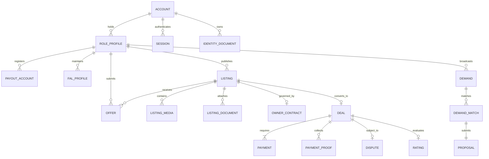

# PRD Addendum: Technical & Operational Specifications

This Addendum accompanies [`prd.md`](file:///c:/Users/mostafa/swoftwear/BMAD/elmasaif/_bmad-output/planning-artifacts/prds/prd-elmasaif-2026-10-26/prd.md) for **El Masaif (المصايف)**. It preserves structural, architectural, state machine, and data specifications extracted from SRS v2.2 to guide downstream BMAD technical workflows (`bmad-architecture`, `bmad-ux`, and `bmad-create-epics-and-stories`).

---

## 1. System Architecture & Technical Baseline

### 1.1 Technology Baseline

| Layer | Selection | Architectural Constraints |
|---|---|---|
| **Frontend** | Next.js (App Router, React, TypeScript) | Presentation layer only. Strictly zero database access, no Prisma client, and no business logic secrets. Communicates via typed API client. |
| **Backend** | NestJS (TypeScript, Node.js LTS) | Modular monolith. Sole owner of business logic, authorization guards, background tasks, and database access. REST endpoints under `/api/v1`. |
| **Database** | PostgreSQL | Relational store. Interactive transactions for deal completion and final approval. |
| **ORM & Migrations** | Prisma + Raw SQL Migrations | Prisma schema owned by API. Raw SQL migrations enforce partial unique indexes and Arabic full-text/trigram search indexes. |
| **Background Jobs** | `@nestjs/schedule` + `pg-boss` | Cron schedules enqueue work into `pg-boss` (Postgres-backed queue), avoiding Redis overhead in MVP. |
| **Validation** | Zod (Shared Package) | Single schema per request shared across web and API, applied in NestJS via global validation pipe. |
| **Localization** | Arabic (RTL primary) & English (LTR) | Web client handles message catalogs, locale formatting, and RTL layout. API returns stable numeric/symbolic error codes. |
| **Monorepo** | pnpm Workspaces | Monorepo layout: `apps/web`, `apps/api`, `packages/shared`, `docs/`. |

### 1.2 REST API & Action Endpoint Conventions
- **Explicit Action Endpoints:** Generic `PATCH /deals/{id}` status mutations are forbidden. State changes execute via explicit action endpoints:
  - `POST /api/v1/deals/{id}/cancel-by-buyer`
  - `POST /api/v1/deals/{id}/dispute`
  - `POST /api/v1/admin/deals/{id}/final-approve`
  - `POST /api/v1/admin/payments/{id}/confirm`
  - `POST /api/v1/admin/payments/{id}/reject`
- **Concurrency Control:** Version column (`version: Int`) with `If-Match` headers on Listing, Offer, and Deal updates; conflicting concurrent writes return HTTP 409 Conflict.
- **Idempotency:** `Idempotency-Key` header enforced on proof uploads, final deal approvals, and payment confirmation decisions.

### 1.3 Task Claim Locking SQL Specification
Operational queue items are claimed using an atomic conditional SQL `UPDATE`:
```sql
UPDATE target_table
SET locked_by_admin_id = $adminId,
    locked_at = ClockService.now(),
    lock_expires_at = ClockService.now() + INTERVAL '15 minutes'
WHERE id = $id
  AND (locked_by_admin_id IS NULL OR lock_expires_at < ClockService.now());
```

---

## 2. State Machine Transition Tables

### 2.1 Deal State Transitions

| Initial State | Target State | Triggering Action / Event | Actor |
|---|---|---|---|
| *(none)* | `AwaitingPaymentProof` | Final deal approval granted (`UC-70B`) | Admin (`Deals.FinalApprove`) |
| `AwaitingPaymentProof` | `PaymentUnderReview` | First payment proof uploaded (`UC-28`) | Buyer |
| `PaymentUnderReview` | `AwaitingPaymentProof` | Proof rejected and no other proof currently pending | System / Admin |
| `AwaitingPaymentProof` | `CancelledByBuyer` | Buyer cancels deal prior to uploading any proof (`UC-29B`) | Buyer |
| `AwaitingPaymentProof` | `CancelledBySeller` | Seller cancellation approved prior to proof upload (`UC-46`) | Admin |
| `AwaitingPaymentProof` / `PaymentUnderReview` | `CancelledByTimeout` | 48-hour deadline passed without on-time pending review (`UC-29A`) | System Scheduler |
| `PaymentUnderReview` | `Completed` | Both payments (Commission & Price) Confirmed (`UC-29`) | System (via Admin UC-71) |
| `PaymentUnderReview` | `Disputed` | Dispute filed after proof upload (`UC-29C`) | Buyer / Seller |
| `Disputed` | `PaymentUnderReview` | Admin returns dispute to review queue (`UC-70C`) | Admin (`Deals.DisputeResolve`) |
| `Disputed` | `Completed` | Admin settles dispute by confirming completion (`UC-70C`) | Admin (`Deals.DisputeResolve`) |
| `Disputed` | `CancelledByAdmin` | Admin settles dispute by cancelling deal (`UC-70C`) | Admin (`Deals.DisputeResolve`) |

*Note: Terminal states are `Completed`, `CancelledByBuyer`, `CancelledBySeller`, `CancelledByTimeout`, and `CancelledByAdmin`.*

### 2.2 Payment State Transitions (Dual: Commission & Price)

| Initial State | Target State | Triggering Action / Event | Actor |
|---|---|---|---|
| `Pending` | `ProofUploaded` | Buyer uploads wire transfer receipt (`UC-28`) | Buyer |
| `ProofUploaded` | `UnderReview` | Admin opens proof in review queue | Admin (`Payments.Review`) |
| `ProofUploaded` / `UnderReview` | `Confirmed` | Admin verifies and approves proof (`UC-71`) | Admin (`Payments.Review`) |
| `ProofUploaded` / `UnderReview` | `Rejected` | Admin rejects proof with mandatory reason (`UC-71`) | Admin (`Payments.Review`) |
| `Rejected` | `ProofUploaded` | Buyer re-uploads replacement proof before deadline | Buyer |
| `Pending` / `ProofUploaded` / `Rejected` | `Expired` | Deal cancels or times out (`UC-29A`) | System Scheduler |

### 2.3 Property Listing State Transitions

| Initial State | Target State | Triggering Action / Event | Actor |
|---|---|---|---|
| `Draft` | `Submitted` | Creator submits listing for review (`UC-34`) | Marketer / Owner |
| `Submitted` | `UnderReview` | Listing enters admin moderation queue | System |
| `UnderReview` | `Active` | Admin approves listing (`UC-63`) | Admin (`Listings.Review`) |
| `UnderReview` | `Rejected` | Admin rejects listing with notes | Admin (`Listings.Review`) |
| `Active` | `Reserved` | Deal created via Final Approval (`UC-70B`) | Admin (`Deals.FinalApprove`) |
| `Reserved` | `Sold` | Deal atomically completes (`UC-29`) | System |
| `Reserved` | `Active` | Deal cancelled or times out (`UC-29A`, `UC-29B`) | System |
| `Active` | `UnderReview` | Major edit made (ask price, location, type) | Marketer / Owner |
| `Active` | `Archived` | Creator archives listing (no active deal) (`UC-39`) | Marketer / Owner |
| `Active` / `Reserved` | `Hidden` | Admin hides listing for non-compliance (`UC-66`) | Admin (`Listings.Compliance`) |
| `Active` / `Reserved` | `Blocked` | Admin blocks listing permanently (`UC-66`) | Admin (`Listings.Compliance`) |
| `Active` | `UnderComplianceReview` | Marketer Fal license expires (`UC-43`) | System Scheduler |
| `UnderComplianceReview` | `Active` | Marketer Fal renewal approved (`UC-43`) | Admin (`Licenses.Review`) |

### 2.4 Owner Listing Contract State Transitions

| Initial State | Target State | Triggering Action / Event | Actor |
|---|---|---|---|
| *(none)* | `Draft` | Owner submits listing request (`UC-50`) | Owner |
| `Draft` | `Submitted` | Request routed to admin | Owner |
| `Submitted` | `ApprovedPendingSignature` | Admin selects template and sets fee (`UC-67`) | Admin (`Contracts.Review`) |
| `ApprovedPendingSignature` | `SignedPendingFee` | Owner signs electronically via OTP (`UC-53`) | Owner |
| `SignedPendingFee` | `FeeUnderReview` | Owner uploads contract fee bank proof (`UC-55`) | Owner |
| `FeeUnderReview` | `Active` | Admin confirms fee proof; listing published (`UC-68A`) | Admin (`ContractFees.Review`) |
| `FeeUnderReview` | `FeeRejected` | Admin rejects proof with reason; re-upload allowed | Admin (`ContractFees.Review`) |
| `SignedPendingFee` | `Expired` | 7-day payment window expires without proof | System Scheduler |
| `Active` | `Completed` | Underlying listing deal completes (`UC-29`) | System |

### 2.5 Fal License Profile State Transitions

| Initial State | Target State | Triggering Action / Event | Actor |
|---|---|---|---|
| *(none)* | `Draft` | Marketer begins onboarding | Marketer |
| `Draft` | `Submitted` / `UnderReview`| Marketer submits certificate and CR (`UC-04`) | Marketer |
| `UnderReview` | `Approved` | Admin validates certificate (`UC-62`) | Admin (`Licenses.Review`) |
| `UnderReview` | `Rejected` | Admin rejects with documented reason | Admin (`Licenses.Review`) |
| `Rejected` | `Resubmitted` / `UnderReview`| Marketer corrects details and re-submits (`UC-05A`)| Marketer |
| `Approved` | `ComplianceRestricted` | License expiry date reached without renewal | System Scheduler |
| `ComplianceRestricted` | `RenewalUnderReview` | Marketer submits renewed certificate (`UC-43`) | Marketer |
| `RenewalUnderReview` | `Approved` | Admin approves renewal (`UC-62`) | Admin (`Licenses.Review`) |

---

## 3. Background Job Catalog (pg-boss & Schedulers)

| Job Name | Cadence | Trigger / Scope | Behavioral Effect & Audit Impact |
|---|---|---|---|
| `payment-deadline-expiry` | Every 60s | Scans Deals where `now() >= PaymentDeadline` | Cancels deals lacking confirmed proofs, subject to 12h grace period for unreviewed on-time proofs. Reverts listing to `Active`. Logs `DealCancelledByTimeout`. |
| `offer-expiry-checker` | Every 5m | Scans Offers where `now() >= OfferExpiry` | Sets offer status to `Expired`. Emits notifications to buyer and seller. |
| `demand-expiry-checker` | Hourly | Scans Demands where `now() >= ExpiresAt` | Sets demand to `Expired`; closes unaccepted proposals. |
| `fal-license-expiry` | Daily (00:05 UTC) | Scans approved Fal profiles where `expiryDate <= today()` | Moves profile to `ComplianceRestricted`; moves active listings to `UnderComplianceReview`. Emits fraud/compliance alert. |
| `fal-expiry-warnings` | Daily (08:00 KSA) | Scans profiles expiring in 30, 7, and 1 days | Dispatches urgent renewal alerts via in-app and email. |
| `owner-fee-reminders` | Daily | Scans contracts in `SignedPendingFee` | Sends payment reminder alerts to owners. |
| `notification-retention` | Daily | Scans notifications older than 90 days | Hard deletes old notification records to optimize table size. |

---

## 4. Admin Permission Matrix (`Area.Action`)

| Permission Key | Description | Default Support Team | Super Admin |
|---|---|:---:|:---:|
| `Users.View` | View accounts, profiles, sessions, and activity logs | Yes | Yes |
| `Users.Status` | Disable, enable, or soft-delete user accounts | No | Yes |
| `Users.HardDelete` | Hard delete account with zero transactional history | No | Yes |
| `Licenses.Review` | Review, approve, or reject Fal license submissions | Yes | Yes |
| `Listings.Review` | Approve, reject, or request changes on property listings | Yes | Yes |
| `Listings.Compliance` | Hide or block listings for regulatory non-compliance | No | Yes |
| `Price.Suggest` | Send official price change suggestions to sellers | Yes | Yes |
| `Contracts.Review` | Review owner listing requests and generate contracts | Yes | Yes |
| `Contracts.FeeOverride`| Override default owner listing contract fee | No | Yes |
| `ContractFees.Review` | Confirm or reject owner contract fee bank proofs | Yes | Yes |
| `Offers.Review` | Content moderation of buyer offers and proposals | Yes | Yes |
| `Deals.View` | View deal pipeline, timelines, and payment proofs | Yes | Yes |
| `Deals.FinalApprove` | Execute final deal approval and activate 48h payment window | No | Yes |
| `Deals.StatusOverride` | Manual deal status override with mandatory reason | No | Yes |
| `Deals.DisputeResolve` | Adjudicate deal disputes and issue binding verdicts | No | Yes |
| `Payments.Review` | Confirm or reject commission and price payment proofs | Yes | Yes |
| `Conversations.Handle` | Review, moderate, and relay mediated inquiry messages | Yes | Yes |
| `Tickets.Handle` | Manage technical support tickets and SLA timers | Yes | Yes |
| `Reports.Handle` | Adjudicate user and listing violation reports | Yes | Yes |
| `Penalties.Apply` | Issue user penalties, broker fines, or account freezes | No | Yes |
| `Fraud.View` | Monitor fraud logs, IBAN changes, and bypass signals | No | Yes |
| `Finance.View` | Access financial analytics, revenue, and commission logs | No | Yes |
| `Settings.Commission` | Modify platform commission rates and fixed fee settings | No | Yes |
| `Settings.Manage` | Configure operational timeouts, file limits, and policies | No | Yes |
| `Rbac.Manage` | Manage administrative roles, permissions, and staff accounts | No | Yes |
| `Content.Manage` | Manage static CMS pages, marketing banners, and FAQ items | No | Yes |
| `Reports.Analytics` | Generate exportable business and operational reports | No | Yes |
| `Bulk.Execute` | Execute batch operations across listings or queues | No | Yes |
| `Notes.Manage` | Create and view internal administrative notes on entities | Yes | Yes |
| `Audit.View` | Inspect immutable system audit logs | No | Yes |
| `Reviews.Moderate` | Moderate buyer-seller ratings and reviews | Yes | Yes |
| `Geo.Manage` | Manage administrative geographic master data: regions, cities, districts | No | Yes |
| `Tasks.ForceUnlock` | Forcibly release active task claim leases with mandatory reason | No | Yes |
| `Users.PhoneChange` | Administrative phone number re-binding with verified proof | No | Yes |
| `Contracts.Manage` | Manage standard owner contract templates and legal clauses | No | Yes |
| `Compliance.Manage` | Administer regulatory compliance, fraud logs, and numeric penalties | No | Yes |
| `Finance.Export` | Export PDF and Excel financial reports and reconciliation data | No | Yes |
| `CMS.Manage` | Author and publish public CMS content, TOS, privacy policy, and FAQ | No | Yes |

---

## 5. Logical Entity Relationship Summary



---

## 6. Notification Event Catalog

| Event Key | Channel | Recipient | Trigger / Payload Summary |
|---|---|---|---|
| `deal.created` | In-App, Email | Buyer, Seller | Deal created; payment instructions, frozen IBAN, and deadline dispatched |
| `deal.payment_deadline_warning` | In-App, Email | Buyer | Approaching PaymentDeadline warnings (12h, 2h before deadline) |
| `deal.payment_under_review` | In-App | Buyer, Seller | Buyer uploaded payment proof; review initiated |
| `deal.proof_rejected` | In-App, Email | Buyer | Payment proof rejected with admin reason; re-upload instructions |
| `deal.completed` | In-App, Email | Buyer, Seller | Both payments confirmed; counterparty contact details disclosed |
| `deal.timeout_cancelled` | In-App, Email | Buyer, Seller | Deal cancelled due to expired payment deadline without on-time proof |
| `deal.disputed` | In-App, Email | Buyer, Seller, Admin | Dispute initiated; automated cancellation suspended pending Super Admin review |
| `payment.sla_alert_4h` | Internal In-App | Support Admins | Proof unreviewed 4 hours after upload; SLA tier 1 alert |
| `payment.sla_escalation_12h` | Internal In-App | Super Admin | Proof unreviewed 12 hours after upload; SLA tier 2 escalation |
| `payment.sla_mandatory_decision_24h` | Internal In-App | Super Admin | Proof unreviewed 24 hours after upload; mandatory Confirm/Reject decision required |
| `listing.submitted` | In-App | Creator | Listing submitted and queued for moderation |
| `listing.approved` | In-App | Creator | Listing approved to Active marketplace status |
| `listing.rejected` | In-App | Creator | Listing rejected with admin modification notes |
| `listing.major_edit_review` | In-App | Creator | Ask price, location, or type edit reverted listing to UnderReview |
| `contract.ready_for_signature` | In-App, Email | Owner | Listing contract template assigned; signature canvas + OTP ready |
| `contract.signed_pending_fee` | In-App | Owner | Contract signed; 7-day fee payment window active |
| `contract.fee_confirmed` | In-App | Owner | Contract fee verified; listing published to Active |
| `contract.fee_expired` | In-App | Owner | Contract fee payment deadline passed; contract expired |
| `fal.expiry_warning` | In-App, Email | Marketer | Expiration warning dispatched at 30, 7, and 1 day(s) before Fal expiry |
| `fal.expired_restricted` | In-App, Email | Marketer | License expired; profile restricted and active listings suspended |
| `demand.matched` | In-App | Providers | New qualifying buyer demand matched to active provider inventory |
| `demand.proposal_received` | In-App | Buyer | Provider proposal approved and ready for buyer review |
| `support.ticket_sla_alert` | Internal In-App | Support Admins | Support ticket nearing first response (4h) or resolution (2d) SLA |
| `auth.security_alert` | In-App, SMS | Account Owner | New device login, password reset, or OTP step-up failure |
| `auth.policy_reconsent_required` | In-App | User | Blocking re-consent screen triggered on terms or privacy policy update |

