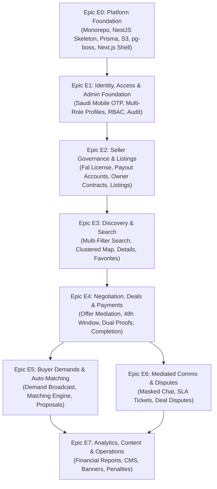

# PRD: Real Estate Marketplace Platform (El Masaif)

## 0. Document Purpose

This Product Requirements Document (PRD) establishes the definitive business, functional, and non-functional specifications for **El Masaif (المصايف)**, an institutional real estate marketplace platform engineered exclusively for property sales across the Kingdom of Saudi Arabia (KSA). 

This document serves as the binding reference for Product Management, System Architecture (`bmad-architecture`), UX/UI Design (`bmad-ux`), Quality Engineering (`bmad-tea`), and vertical slice sprint execution (`bmad-create-epics-and-stories`). It formalizes requirements originally outlined in the Software Requirements Specification (SRS v2.2) and the Product Brief approved on 2026-10-26. Technical implementation mechanics, physical database schemas, and state machine transition tables are preserved in the accompanying [`addendum.md`](file:///c:/Users/mostafa/swoftwear/BMAD/elmasaif/_bmad-output/planning-artifacts/prds/prd-elmasaif-2026-10-26/addendum.md).

---

## 1. Vision

**El Masaif** is a mediated, trust-first digital marketplace dedicated exclusively to real estate property sales in the Kingdom of Saudi Arabia. In contrast to conventional unmoderated classified portals where contact poaching, unlicensed intermediaries, and fraudulent listings are rampant, El Masaif introduces an institutional-grade transaction pipeline. Every inquiry, property offer, counter-offer round, and deal negotiation is systematically mediated through platform administration, ensuring that direct counterparty communication remains strictly locked until a transaction has been officially verified and completed.

The platform operationalizes a non-custodial financial architecture tailored to Saudi financial and regulatory realities: the platform never holds multi-million SAR property purchase funds in digital escrow. Instead, property buyers transfer the agreed purchase price directly to the verified seller (Owner or licensed Marketer) via external bank transfer, while platform commissions and owner contract fees are transferred directly to the designated platform bank account. Platform operators audit both payment proofs against verified Saudi IBANs and generated bank reference codes before approving deal completion. Built as a high-performance responsive web application (Arabic RTL-first in Next.js) backed by an independent NestJS REST API and PostgreSQL, El Masaif establishes transparency, regulatory compliance under the Real Estate General Authority (REGA), and transaction velocity for residential and commercial property sales.

---

## 2. Target User

### 2.1 Jobs To Be Done (JTBD)

- **The Property Buyer (Investor / Home Seeker):**
  - *Functional:* "When I want to purchase property in KSA, I want to search vetted listings with accurate single ask prices, submit structured property requests (Demands), and negotiate binding offers through a protected channel, so that I don't waste time on ghost listings or uncertified middlemen."
  - *Emotional / Social:* "I want confidence that the seller is legitimate, the title deed is authentic, and my high-value bank transfer is validated before contracts and contact details are finalized."
- **The Licensed Marketer (Real Estate Broker):**
  - *Functional:* "When I market properties under my Fal license, I want exclusive lead protection, automated demand matching, and a structured offer negotiation pipeline, so that outside brokers cannot bypass me or steal my seller listings."
  - *Emotional:* "I want to be recognized as an authorized professional in full compliance with REGA regulations without regulatory liability."
- **The Direct Property Owner:**
  - *Functional:* "When I sell my residential or commercial asset, I want to publish my listing backed by a standardized electronic contract and receive qualified offers without receiving unsolicited broker phone calls."
  - *Financial:* "I want the agreed property sale price transferred directly to my verified Saudi bank account without middlemen taking unauthorized markups."
- **The Platform Operator / Administrator:**
  - *Functional:* "When managing daily platform operations, I want central queues to moderate listings, review Fal licenses, mediate negotiations, and verify dual bank transfer proofs against an immutable audit log under granular RBAC."

### 2.2 Non-Users (v1)

- **Tenants and Landlords:** Residential or commercial rental, leasing, and property management are strictly out of scope in v1.
- **Real Estate Auction Seekers:** Court-ordered, judicial, or public live auction operations are excluded.
- **Installment Financing / Mortgage Borrowers:** Mortgage brokerage, consumer credit scoring, and direct lender origination integrations are not served in v1.
- **Unlicensed Freelance Middlemen:** Individuals lacking a valid, verifiable REGA Fal license are legally barred from marketing properties.

### 2.3 Key User Journeys

#### UJ-1. Tariq Buys an Executive Villa in Riyadh via Dual External Bank Transfer
- **Persona & Context:** Tariq, a 38-year-old financial analyst buying a primary residence for his family in Riyadh, navigating high-value real estate.
- **Entry State:** Authenticated via Saudi mobile OTP on the responsive web application (`/app/buyer`), profile status `Active`, national ID document uploaded.
- **Path:**
  1. Tariq browses Riyadh villas using the interactive map with green markers and filters for 4+ bedrooms and a budget cap of SAR 3,200,000.
  2. He inspects Listing #1042 (ask price: SAR 3,100,000). The dynamic fee calculator shows an estimated platform commission of SAR 77,500 (2.5%) and estimated total of SAR 3,177,500.
  3. Tariq submits a formal offer of SAR 2,950,000. The offer enters the Admin Review Queue.
  4. Platform Admin approves and relays the offer to the seller. The seller counter-offers SAR 3,000,000. Tariq receives an in-app notification and accepts.
  5. Admin reviews the accepted negotiation and triggers Final Approval. Deal #408 is created with `status: AwaitingPaymentProof` and a 48-hour countdown timer begins. Listing #1042 becomes `Reserved`.
  6. The Deal screen displays frozen financial snapshots: Deal Price SAR 3,000,000, Platform Commission SAR 75,000 (2.5%), Total SAR 3,075,000. It displays:
     - Payment 1 (Commission): Platform IBAN + generated Deal Reference Code (`ELM-408-C`).
     - Payment 2 (Price): Seller's verified Saudi IBAN and account holder name.
  7. Tariq executes two external wire transfers via his bank mobile app, uploads PDF receipts for both, and submits.
- **Climax:** Admin confirms both proofs. System atomically transitions Deal to `Completed`, sets Listing to `Sold`, releases the seller's direct phone number to Tariq, and unlocks seller rating.
- **Resolution:** Tariq receives the seller's contact details to arrange title deed deed transfer (Ifragh) at the notary, and submits a 5-star review.
- **Edge Case:** If Tariq uploads payment proofs at hour 47:00, the automated 48-hour background timeout job detects active unreviewed proofs and grants a 12-hour administrative review grace period rather than terminating the transaction.

#### UJ-2. Sara Onboards as a Licensed Marketer and Lists a Commercial Office
- **Persona & Context:** Sara, a licensed Saudi real estate broker operating in Jeddah under an individual Fal Brokerage and Marketing License.
- **Entry State:** Registered account holder on desktop browser, toggles account role to `Marketer`.
- **Path:**
  1. Sara submits her business credentials: Fal license number, certificate PDF, license expiry date, commercial name, and 10-digit Commercial Registration (CR) number.
  2. Her profile enters `UnderReview`. While awaiting approval, she navigates to Payout Settings and adds her verified Saudi IBAN (mod-97 validated).
  3. Support Team verifies her Fal certificate in the Admin Licensing Queue and approves the profile. Sara receives notification and unlocks the Marketer Workspace (`/app/marketer`).
  4. Sara creates a listing for a commercial office in Al-Rawdah, Jeddah: ask price SAR 1,850,000, property specs, 8 high-resolution photos, title deed document (`AdminOnly`), owner authorization certificate (`AdminOnly`), and selects her registered payout IBAN.
  5. Admin compliance reviews the authorization and listing parameters, approving it to `Active`.
- **Climax:** Sara's listing appears on the public marketplace with her public broker rating and active listing tally; her personal phone and email remain shielded.
- **Resolution:** When an offer arrives, Sara reviews mediated terms directly in her portal without dealing with unauthorized intermediary calls.
- **Edge Case:** When Sara's Fal license reaches 30 days, 7 days, and 1 day before expiration, the system issues compliance warnings. If unrenewed upon expiration date, a daily cron job automatically flags her profile `ComplianceRestricted` and transitions her active listings to `UnderComplianceReview`.

#### UJ-3. Abu Fahad Signs an Electronic Listing Contract as a Direct Owner
- **Persona & Context:** Abu Fahad, a 60-year-old property owner in Dammam wishing to sell his commercial building without hiring an outside broker.
- **Entry State:** Authenticated user, selects `Owner` role profile.
- **Path:**
  1. Abu Fahad enters `/app/owner` and submits a Listing Request for his building: property details, title deed copy (`AdminOnly`), ask price SAR 4,500,000, and his verified personal Saudi IBAN.
  2. Admin evaluates the request and selects the Standard Owner Listing Contract Template, assigning a default contract fee of SAR 1,000.
  3. Abu Fahad receives an in-app alert: "Listing Contract Ready for Signature."
  4. He reviews the contract terms on the web interface, draws his signature on the signature pad, and enters a 6-digit OTP dispatched to his registered mobile number to stamp the document.
  5. Abu Fahad initiates a bank transfer of SAR 1,000 to the platform bank account and uploads the wire receipt.
- **Climax:** Admin confirms the contract fee proof. The listing transitions automatically from pending fee to `Active` on the marketplace.
- **Resolution:** Abu Fahad monitors buyer inquiries and incoming mediated offers from his dedicated Owner Dashboard.
- **Edge Case:** If the contract fee proof is rejected due to an incorrect reference number, Abu Fahad is notified with the exact admin reason and can re-upload a corrected bank receipt before the 7-day contract deadline expires.

#### UJ-4. Mansour Broadcasts a Buyer Demand and Closes via Automated Inventory Matching
- **Persona & Context:** Mansour, an investment manager looking to acquire residential land plots in Al-Khobar within a specific budget.
- **Entry State:** Authenticated Buyer on mobile web.
- **Path:**
  1. Mansour opens `/app/buyer/requests` and clicks "Submit Demand."
  2. He specifies: City = Al-Khobar, Property Type = Land, Budget = SAR 2,000,000, Required Area = 600 m² (with implicit ±20% tolerance: 480–720 m²), and notes on soil condition.
  3. Submitting the Demand is free; the Demand transitions immediately to `Active` with an expiry window of 30 days.
  4. The platform Matching Engine scans active inventory and identifies 3 qualified Providers (marketers and owners with active listings matching criteria).
  5. Marketer Hisham receives an instant Demand notification and attaches his active Land Listing #882 as a formal Proposal with an offered price of SAR 1,950,000.
  6. Admin performs content review and approves the proposal for buyer visibility.
- **Climax:** Mansour receives the approved proposal on his Demand dashboard, compares the land specs, and clicks "Select Offer."
- **Resolution:** The proposal advances to `SelectedPendingFinalAdminApproval`, prompting Admin to generate Deal #512 and initiate the 48-hour dual payment pipeline.
- **Edge Case:** If the seller rejects or Admin denies final approval, Mansour's Demand returns to `Active` status, enabling him to choose alternative proposals or await new matches.

#### UJ-5. Khalid (Support Admin) Mediates an Offer and Validates Dual Bank Proofs
- **Persona & Context:** Khalid, a platform operations specialist in Riyadh managing the Admin Back-Office (`/admin`).
- **Entry State:** Authenticated in the dedicated Admin Realm with role `Support Team` (permissions `Offers.Review`, `Deals.View`, `Payments.Review`, `Conversations.Handle`).
- **Path:**
  1. Khalid monitors the Admin Dashboard. An alert highlights an incoming buyer inquiry on Listing #1042 containing a masked phone number attempt ("050-XXXXXXX").
  2. Khalid reviews the conversation queue, strips the off-platform communication attempt, and relays the legitimate property specification query to the seller.
  3. Next, Khalid inspects the Payment Review Queue for Deal #408 (total deal value SAR 3,075,000).
  4. He opens Payment 1 (Commission SAR 75,000): inspects the uploaded PDF receipt, verifies the transaction reference code matches `ELM-408-C`, checks amount, and clicks `Confirm Payment`.
  5. He opens Payment 2 (Property Price SAR 3,000,000): cross-references the uploaded bank transfer slip against the Deal's frozen Seller Payout IBAN and account holder name. Everything matches. He clicks `Confirm Payment`.
- **Climax:** The system validates that both payment records are `Confirmed`, atomically commits `Deal = Completed`, transitions `Listing = Sold`, sends transactional notifications, and archives active negotiation threads.
- **Resolution:** Khalid logs internal verification notes; the immutable audit log records his action with timestamp, admin ID, and checksum.
- **Edge Case:** If Payment 2 shows an IBAN mismatch or suspected altered receipt, Khalid flags the payment as `Rejected` with a mandatory reason ("IBAN does not match registered seller payout account SA..."), which immediately notifies the buyer to upload the authentic receipt before the payment window expires.

---

## 3. Glossary

The following domain terms are canonical. All functional requirements, user journeys, data models, and downstream technical artifacts must use these terms verbatim.

| Term | Definition & Domain Rules |
|---|---|
| **Account** | The singular identity record tied to one verified Saudi mobile number (`+9665XXXXXXXX`), holding credentials and linked role profiles. |
| **Role Profile** | A specialized capability attached to an Account: `Buyer`, `Marketer`, or `Owner`. An Account can hold multiple active role profiles. |
| **Provider** | A registered `Marketer` (holding an approved Fal license) or an `Owner` (holding an active listing contract) qualified to publish listings and respond to Demands. |
| **Seller** | The specific Provider who owns or represents an active Listing and receives the property purchase price. |
| **Fal License** | The official real estate brokerage authorization issued by the Real Estate General Authority (REGA), mandatory for all Marketer operations. |
| **Listing** | A residential or commercial real estate asset published for sale at a single ask price. Rentals are excluded. |
| **Ask Price** | The single monetary amount (in SAR) demanded by the seller on a listing (min 1, max 50,000,000 SAR). Price ranges are prohibited. |
| **Offer** | A formal price proposal submitted by a Buyer on a specific Listing or in response to a Demand. |
| **Counter-Offer** | A revised price proposal transmitted between Buyer and Seller through Admin mediation; increments `NegotiationRound`. |
| **Backup Offer** | An offer submitted on a listing whose status is currently `Reserved` due to an in-flight Deal. |
| **Demand** | A structured property request broadcast by a Buyer specifying property type, city, budget, and area requirements. |
| **Matching Engine** | The automated system service that pairs active Demands with qualifying Provider listings within defined criteria tolerances. |
| **Proposal** | A Provider's formal submission linking an active qualifying Listing to a Buyer's Demand. |
| **Deal** | The legal and transactional entity created exclusively by final administrative approval (`UC-70B`), governing the dual payment workflow. |
| **Platform Commission** | The platform service fee paid by the Buyer directly to the platform bank account (default 2.5% of deal price + fixed fee). |
| **Price Payment** | The agreed property purchase price transferred directly from the Buyer to the Seller's verified Saudi bank account. |
| **Payout Account** | The verified Saudi bank account (holder name and mod-97 validated IBAN) registered by a Seller to receive property price payments. |
| **Payment Proof** | A document (PDF/image) uploaded by a Buyer verifying execution of an external bank transfer. |
| **PaymentDeadline** | The exact timestamp (`Deal.createdAt + PaymentWindowHours`, default 48h) by which both payment proofs must be confirmed. |
| **Financial Snapshot** | Immutable financial data (`FinalDealPrice`, `CommissionRateSnapshot`, `FixedCommissionSnapshot`, `FinalCommission`, `FinalTotal`, `SellerPayoutAccount`) frozen on the Deal at creation. |
| **Mediation** | The mandatory platform process routing all inquiries, messages, offers, and counter-offers through Admin queues to prevent direct contact. |
| **Dispute** | A formal objection raised by Buyer or Seller after payment proof upload, which suspends automated timeouts and deal completion. |
| **Owner Contract** | The binding listing agreement between the platform and a direct Property Owner, requiring electronic signature and contract fee payment. |
| **Contract Fee** | The administrative fee paid by an Owner to the platform before an Owner listing can be published. |
| **Dynamic RBAC** | Granular Role-Based Access Control governing administrator permissions (`Area.Action`) within the isolated admin back-office. |
| **Audit Event** | An immutable, insert-only log record documenting actor, timestamp, action, entity, previous value, new value, and operational reason. |
| **OtpProvider** | The swappable system interface executing one-time password delivery (static dev code `123456` in development; SMS gateway in production). |
| **IBAN** | International Bank Account Number for Saudi Arabia (`SA` followed by 2 check digits and 22 alphanumeric characters, total 24 chars). |
| **SAR** | Saudi Riyal, the sole currency supported across all platform listings, offers, deals, and reports. |
| **PDPL** | Personal Data Protection Law of the Kingdom of Saudi Arabia, governing the handling and retention of user identity and financial records. |

---

## 4. Features & Functional Requirements

### 4.1 Identity, Multi-Role Access & Account Governance
**Description:** Provides secure authentication anchored to verified Saudi mobile phone numbers. Supports multi-role profiles allowing a single user account to toggle between Buyer, Marketer, and Owner workspaces without re-registering. Enforces secure session management, ID document storage, and payout account setup.

#### FR-1: Saudi Mobile Registration & OTP Verification
- **Capability:** A visitor can register an account by submitting their full name (3–100 chars) and Saudi mobile number (`^(\+966|0)5[0-9]{8}$`, normalized to `+9665XXXXXXXX`), verifying possession via a 6-digit OTP, and configuring a unique username and password. Realizes UJ-1, UJ-2, UJ-3.
- **Consequences (testable):**
  - System rejects non-Saudi phone formats with error `AUTH_INVALID_PHONE`.
  - OTP expires after 300 seconds; resend is throttled to 1 request per 60 seconds and max 3 requests per hour per phone.
  - 3 consecutive incorrect OTP entries lock verification for 15 minutes.
  - Password must be at least 8 characters containing at least one letter and one number `[ASSUMPTION: A-02]`.

#### FR-2: Returning User Login & Session Handling
- **Capability:** Registered users can authenticate using username/phone and password, issuing an HttpOnly, Secure session cookie with rolling 30-day expiry `[ASSUMPTION: A-03]`. Realizes UJ-1.
- **Consequences (testable):**
  - 5 consecutive failed login attempts lock account login for 15 minutes `[ASSUMPTION: A-04]`.
  - Logging in from a new device or expired session triggers step-up OTP verification.
  - Disabled or soft-deleted accounts receive explicit status rejection errors.

#### FR-3: Multi-Role Profile Switching
- **Capability:** An authenticated user can attach multiple role profiles (`Buyer`, `Marketer`, `Owner`) to their single account and switch workspaces via the account menu without re-authenticating. Realizes UJ-2, UJ-3.
- **Consequences (testable):**
  - Adding the `Owner` role is instantaneous.
  - Adding the `Marketer` role requires completing Fal license onboarding (FR-8) and remains disabled until admin approval.
  - Current active role scopes API authorization guards on subsequent requests.

#### FR-4: Identity Document Verification
- **Capability:** Users can upload a national identity document (National ID / Iqama) in PDF/JPEG/PNG format up to 10 MB, stored securely with `AdminOnly` visibility. Realizes UJ-1.
- **Consequences (testable):**
  - System verifies document existence before allowing a Buyer to upload Deal payment proofs (BR-10).
  - Identity files are accessible only by platform admins and the document owner via signed URLs expiring in <= 5 minutes.

#### FR-5: Seller Payout Account Management
- **Capability:** Marketers and Owners can register and manage at least one payout account consisting of account holder name (3–100 chars) and a 24-character Saudi IBAN. Realizes UJ-1, UJ-2, UJ-3.
- **Consequences (testable):**
  - System executes format validation and mod-97 checksum validation; invalid IBANs return `PAYOUT_INVALID_IBAN`.
  - Creating or updating a payout account requires step-up OTP confirmation and logs an immutable audit event (BR-05).
  - System prohibits modifying or deleting any payout account currently bound to an active, non-terminal Deal.
  - Name mismatch between account holder and user commercial name flags an administrative warning `[ASSUMPTION: A-10]`.

---

### 4.2 Licensing & Owner Contract Governance
**Description:** Enforces strict regulatory compliance for property sellers. Marketers must maintain verified, unexpired Fal licenses under REGA regulations. Direct Owners must execute standardized electronic listing agreements and pay listing contract fees prior to property publication.

#### FR-6: Fal License Submission & Administrative Review
- **Capability:** A Marketer applicant can submit business credentials (license certificate file, license number, license expiration date, commercial name, 10-digit CR number, and up to 5 supporting documents) for admin verification. Realizes UJ-2.
- **Consequences (testable):**
  - Submitting sets `FalProfile = UnderReview` and routes the item to the Admin Licensing Queue.
  - Expiration date set in the past is rejected on client and server (`FAL_EXPIRED_DATE`).
  - Admin approval transitions profile to `Approved` and dispatches notification; rejection requires a documented reason and permits re-submission.

#### FR-7: Automated Fal Expiry Enforcement
- **Capability:** The platform executes a daily background job to track Fal license expiration dates and enforce immediate compliance restrictions upon expiry. Realizes UJ-2.
- **Consequences (testable):**
  - Automated warnings are dispatched to Marketers 30 days, 7 days, and 1 day prior to license expiration `[ASSUMPTION: A-05]`.
  - On the expiration date, the job automatically sets `FalProfile = ComplianceRestricted` and moves all linked `Active` listings to `UnderComplianceReview` (BR-14).
  - Existing in-flight Deals continue unaffected to completion.

#### FR-8: Fal License Renewal
- **Capability:** A restricted or expiring Marketer can submit an updated Fal certificate and extended expiration date for administrative re-review. Realizes UJ-2.
- **Consequences (testable):**
  - Profile transitions to `RenewalUnderReview`.
  - Upon admin approval, eligible listings held in `UnderComplianceReview` automatically return to `Active`.

#### FR-9: Owner Contract Generation & Electronic Signature
- **Capability:** A direct Owner can request property publication, review an admin-assigned contract template, and execute a legally binding electronic signature using an interactive signature canvas plus OTP confirmation. Realizes UJ-3.
- **Consequences (testable):**
  - Contract captures timestamp, user IP, device user agent, drawn signature raster, and verified OTP record.
  - Signed contract transitions to `SignedPendingFee` with a payment window of 7 days (`ContractFeeDeadline`) `[ASSUMPTION: A-06]`.

#### FR-10: Owner Contract Fee Verification
- **Capability:** An Owner can upload bank transfer proof for the listing contract fee (default SAR 1,000, configurable per listing by admin) to the platform bank account. Realizes UJ-3.
- **Consequences (testable):**
  - Proof upload transitions payment to `ProofUploaded` / `FeeUnderReview`.
  - Admin confirmation transitions contract to `Active` and automatically publishes the owner's listing to `Active` marketplace status (BR-15).
  - Contract fees are strictly non-refundable once confirmed `[ASSUMPTION: OQ-08]`.

---

### 4.3 Property Listing Lifecycle & Media Management
**Description:** Manages residential and commercial property inventory strictly dedicated to sales. Governs listing creation, multi-image upload, administrative moderation, compliance review, and lifecycle state changes.

#### FR-11: Listing Creation & Field Specifications
- **Capability:** Providers can create listings for sale with title, property type (Apartment, Villa, Land, Building, Office), location coordinates (lat/long), city, district, single ask price (1 to 50,000,000 SAR), land area (m²), specifications, and bound payout IBAN. Realizes UJ-2, UJ-3.
- **Consequences (testable):**
  - System rejects rental listings or multi-tier price ranges (BR-01, BR-13).
  - Marketers must upload an Owner Authorization Document (`AdminOnly`) proving authorization to sell the property `[ASSUMPTION: OQ-06]`.
  - Mandatory minimum 3 photos and maximum 20 photos (JPEG/PNG/WebP, max 10 MB per file).

#### FR-12: Document Visibility & Classification
- **Capability:** Listing creators can upload supporting documents and assign visibility flags (`Public` or `AdminOnly`). Realizes UJ-1, UJ-2.
- **Consequences (testable):**
  - Title deeds, commercial registers, Fal certificates, and authorization agreements are enforced as `AdminOnly` (BR-21).
  - Public documents (e.g., property floor plans) are visible to buyers on the listing details page; `AdminOnly` documents are never returned to non-admin API consumers.

#### FR-13: Listing Moderation & Approval
- **Capability:** Administrators can review submitted listings, approve them to `Active`, reject with notes, or request modifications. Realizes UJ-2, UJ-5.
- **Consequences (testable):**
  - Approved listings immediately appear in public search and map results.
  - Major edits to an `Active` listing (ask price, location, property type) reset status to `UnderReview`.
  - Minor edits (description, supplemental photos) apply immediately without resetting approval status (BR-13).

#### FR-14: Listing Archiving & Compliance Suspension
- **Capability:** Sellers can archive `Active` listings that have no active in-flight Deal; administrators can hide or block non-compliant listings immediately. Realizes UJ-2, UJ-5.
- **Consequences (testable):**
  - System blocks archiving or deleting any listing currently in `Reserved` status or linked to an active Deal.
  - Admin blocking immediately hides the listing from search and cancels non-deal pending offers (BR-16).

---

### 4.4 Discovery, Search & Spatial Visualization
**Description:** Enables buyers to discover properties through multi-faceted search filters, responsive paginated lists, and an interactive colored map interface.

#### FR-15: Multi-Criteria Filter Search
- **Capability:** Buyers can filter listings by free text, property type, city, district, price range, area range, and bedroom count. Realizes UJ-1.
- **Consequences (testable):**
  - Search results return only `Active` and `Reserved` listings; sold, archived, hidden, and blocked properties are excluded.
  - Results are paginated (default 20 per page, max 100) and sortable by newest, price ascending, and price descending.
  - Query execution meets p95 latency target < 800 ms under 50,000 active listings.

#### FR-16: Interactive Clustered Map View
- **Capability:** Buyers can view listing locations on an interactive map featuring marker clustering below zoom level 12 and color-coded pins by property type (Apartment = Blue, Villa = Green, Land = Orange, Building = Purple, Office = Red). Realizes UJ-1.
- **Consequences (testable):**
  - Clicking a marker opens a compact listing preview card with photo, ask price, area, and status badge.
  - Map dynamically synchronizes markers with active filter criteria from FR-15.

#### FR-17: Listing Detail & Dynamic Fee Breakdown
- **Capability:** Buyers can inspect complete listing details, media carousel, specifications, seller public profile, and live platform commission calculation. Realizes UJ-1.
- **Consequences (testable):**
  - Screen dynamically displays: Ask Price, Estimated Platform Commission (2.5%), and Estimated Total (BR-02).
  - Direct seller phone and email are completely concealed (BR-06).
  - Reserved listings display a prominent `Reserved` badge and restrict actions to Backup Offers only (BR-13).

#### FR-18: Similar Listings Engine
- **Capability:** The listing screen displays 4–6 similar properties matching property type, city/district, and price within |SimilarPrice − CurrentPrice| / CurrentPrice <= 0.20. Realizes UJ-1.
- **Consequences (testable):**
  - Excludes the current listing and all non-active listings.

#### FR-19: Seller Public Profile & Reputation
- **Capability:** Buyers can review a seller's public profile displaying commercial name, verified badge, average star rating, completed deal count, and active listings. Realizes UJ-1.
- **Consequences (testable):**
  - Contact information is concealed; individual buyer review comments are displayed publicly.

#### FR-20: Favorites List
- **Capability:** Authenticated buyers can bookmark up to 100 favorite listings and review them in a dedicated favorites screen. Realizes UJ-1.
- **Consequences (testable):**
  - Bookmarked listings that become `Sold`, `Archived`, or `Reserved` display updated status badges within the favorites view.

---

### 4.5 Buyer Demands & Automated Inventory Matching
**Description:** Allows buyers to post specific property purchase requirements (Demands) and automates matching against qualified Provider inventory, eliminating manual broker searching.

#### FR-21: Demand Submission
- **Capability:** Buyers can post a property demand specifying budget (SAR), city/region, property type, required area (m²), and optional specifications (up to 1,000 chars) free of charge. Realizes UJ-4.
- **Consequences (testable):**
  - Demand transitions immediately to `Active` with `ExpiresAt = createdAt + 30 days` without requiring prior admin approval (BR-12).
  - Background hourly cron job marks expired Demands as `Expired`.

#### FR-22: Automated Demand Matching Engine
- **Capability:** The system matching engine evaluates new Demands against active listings and instantly dispatches notifications to qualifying Providers. Realizes UJ-4.
- **Consequences (testable):**
  - Matching criteria: Provider has >= 1 `Active` non-reserved listing with identical property type, city, `askPrice <= budget`, and area within ±20% tolerance `[ASSUMPTION: A-08]`.
  - Dispatches to all qualifying providers without Top-N truncation.

#### FR-23: Provider Proposal Submission & Admin Review
- **Capability:** A matched Provider can attach one of their active matching listings to the Demand and submit a binding proposed price and terms. Realizes UJ-4.
- **Consequences (testable):**
  - Proposal is submitted with status `PendingAdminReview`.
  - Admin content review approves proposal to `ApprovedForBuyer` or rejects it; unapproved proposals are invisible to the buyer.

#### FR-24: Buyer Proposal Selection
- **Capability:** A Buyer can review approved proposals for their Demand and select their preferred offer. Realizes UJ-4.
- **Consequences (testable):**
  - Selecting an offer sets proposal status to `SelectedPendingFinalAdminApproval` and routes to Admin Final Approval (UC-70B).
  - No Deal is created until administrative approval; if Admin rejects, Demand returns to `Active` status.

---

### 4.6 Offer Mediation & Structured Negotiation
**Description:** Enforces structured, auditable price negotiations on listings. Eliminates informal verbal agreements by routing all initial offers, counter-offers, and acceptances through administrator moderation queues.

#### FR-25: Offer Submission & Price Guardrails
- **Capability:** An authenticated Buyer can submit a formal purchase offer on an `Active` or `Reserved` listing with price (1 to 50,000,000 SAR) and notes (up to 500 chars). Realizes UJ-1.
- **Consequences (testable):**
  - If offer price < 50% of listing ask price, system requires explicit low-price confirmation before submission (BR-11).
  - Offer on a `Reserved` listing is flagged as `IsBackup = true`.
  - System enforces a limit of one active offer per Buyer per listing `[ASSUMPTION: A-07]`.
  - Offer transitions to `PendingAdminReview`.

#### FR-26: Mediated Counter-Offer Rounds
- **Capability:** Buyers and Sellers can exchange counter-offers mediated by Admin content reviews, subject to maximum round caps and expiration timeouts. Realizes UJ-1.
- **Consequences (testable):**
  - Each counter-offer increments `NegotiationRound`; system rejects counter-offers exceeding `MaxCounterRounds` (default 5 rounds, configurable).
  - Unanswered offers expire after `OfferExpiryDays` (default 7 days, configurable via background job).
  - When both parties agree on a price, the offer transitions to `SelectedPendingFinalAdminApproval`.

#### FR-27: Backup Offer Pipeline
- **Capability:** Backup offers on `Reserved` listings are reviewed and held in reserve until the primary Deal completes or cancels. Realizes UJ-1.
- **Consequences (testable):**
  - If the primary Deal is cancelled or times out, the oldest approved Backup Offer is surfaced to the Admin for potential activation `[ASSUMPTION: OQ-04]`.
  - If the primary Deal is `Completed`, all active backup offers are closed automatically.

---

### 4.7 Deals, Dual Payment Proofs & Completion Engine
**Description:** The core transactional engine of El Masaif. Enforces non-custodial financial safety through a strict 48-hour payment window, dual bank wire proofs (Commission and Price), and atomic state completion.

#### FR-28: Final Deal Approval & State Machine Binding
- **Capability:** An authorized Administrator (`Deals.FinalApprove`) can grant final approval to an agreed offer, creating Deal record and locking the listing. Realizes UJ-1, UJ-5.
- **Consequences (testable):**
  - Transaction atomically creates `Deal` with `status: AwaitingPaymentProof` and sets `Listing = Reserved`.
  - Enforces database constraint: at most one non-terminal Deal per listing (BR-07).
  - Sets `PaymentDeadline = now() + 48 hours`.

#### FR-29: Immutable Financial Snapshot Freezing
- **Capability:** Upon Deal creation, the system freezes all financial and payout parameters directly onto the Deal record. Realizes UJ-1.
- **Consequences (testable):**
  - Freezes `FinalDealPrice`, `CommissionRateSnapshot` (default 2.5%), `FixedCommissionSnapshot` (default 0 SAR), `FinalCommission`, `FinalTotal`, and `SellerPayoutAccount` (holder name and IBAN) (BR-02, BR-05).
  - Subsequent global settings modifications never alter existing Deal snapshot values.

#### FR-30: Dual Payment Proof Upload
- **Capability:** The Buyer must upload two distinct external bank transfer receipts (PDF/JPEG/PNG, max 10 MB): Payment 1 (Commission to platform IBAN with Deal Reference Code) and Payment 2 (Price to Seller Payout IBAN). Realizes UJ-1.
- **Consequences (testable):**
  - Buyer cannot upload any proof without an existing uploaded National ID document (FR-4, BR-10).
  - Proof upload sets corresponding payment record to `ProofUploaded` and transitions Deal to `PaymentUnderReview`.
  - Buyer can re-upload rejected proofs any number of times prior to `PaymentDeadline`.

#### FR-31: Administrative Proof Review & 12-Hour Grace Period
- **Capability:** Administrators review uploaded proofs independently against bank accounts and checksums, approving or rejecting each payment. Realizes UJ-1, UJ-5.
- **Consequences (testable):**
  - Admin approves proof → payment transitions to `Confirmed`.
  - Admin rejects proof → payment transitions to `Rejected` with mandatory reason; buyer is notified immediately.
  - If proofs are uploaded before `PaymentDeadline` but remain `ProofUploaded` or `UnderReview` at the 48-hour mark, the system pauses automatic cancellation and applies a 12-hour administrative grace period `[DECISION: OQ-07]`.

#### FR-32: Atomic Deal Completion
- **Capability:** When both Payment 1 and Payment 2 are `Confirmed` before the deadline, the system atomically completes the transaction. Realizes UJ-1, UJ-5.
- **Consequences (testable):**
  - Single database transaction executes: `Deal = Completed`, `Listing = Sold`, linked Owner Contract (if applicable) = `Completed`, all competing/backup offers on listing = `Closed`.
  - Discloses counterparty contact information (phone and email) to Buyer and Seller (BR-06).
  - Unlocks 1–5 star rating submission for the Buyer.

#### FR-33: Automated Payment Timeout Cancellation
- **Capability:** A background cron job running every 60 seconds evaluates deals past their `PaymentDeadline` and cancels uncompleted transactions. Realizes UJ-1.
- **Consequences (testable):**
  - If `now() > PaymentDeadline`, deal is not `Disputed`, and proofs are not pending under the 12h grace period: `Deal = CancelledByTimeout`, unconfirmed payments = `Expired`, and `Listing` reverts from `Reserved` to `Active`.
  - Dispatches cancellation alerts to Buyer, Seller, and Admin.

#### FR-34: Buyer Cancellation Before Payment
- **Capability:** A Buyer can cancel an active Deal while `status: AwaitingPaymentProof` provided no payment proofs have been uploaded. Realizes UJ-1.
- **Consequences (testable):**
  - Deal transitions to `CancelledByBuyer`; listing reverts from `Reserved` to `Active`.
  - Action is disabled once any proof file has been submitted.

---

### 4.8 Mediated Communication, Support & Dispute Resolution
**Description:** Protects transaction integrity by preventing off-platform communication bypasses, providing customer support ticketing, and resolving post-payment deal disputes.

#### FR-35: Mediated Listing Inquiries & Automatic Contact Masking
- **Capability:** Buyers can submit inquiries regarding an active listing, creating a mediated conversation thread routed to the Admin Conversation Queue. Realizes UJ-5.
- **Consequences (testable):**
  - Direct communication between Buyer and Seller is prohibited; Admin reviews and relays messages.
  - System automatically detects and masks Saudi phone numbers (`05XXXXXXXX`), emails, and social media handles in message text `[ASSUMPTION: R-04]`.
  - Message attachments are limited to 5 files (PDF/image, 10 MB max).

#### FR-36: Deal Dispute Filing & Freeze
- **Capability:** A Buyer or Seller can file a formal Dispute on an active Deal after at least one payment proof has been uploaded. Realizes UJ-5.
- **Consequences (testable):**
  - Deal status transitions to `Disputed`.
  - Automated timeout cancellation and completion jobs are immediately suspended for the disputed deal.
  - Dispute routes to the Super Admin queue for adjudication (`Deals.DisputeResolve`).
  - Adjudication outcomes: Admin can return deal to `PaymentUnderReview`, force `Completed`, or trigger `CancelledByAdmin`.

#### FR-37: Violation Reporting
- **Capability:** Any user can report a fraudulent listing, abusive seller, or unauthorized broker, submitting category, explanation, and up to 5 attachments. Realizes UJ-1.
- **Consequences (testable):**
  - Report lands in Admin Reports Queue (`Reports.Handle`). Reporter does not track ticket progress in MVP (submit-only).

#### FR-38: Support Ticketing System
- **Capability:** Users can open technical support tickets; support admins manage tickets with statuses `Open`, `InProgress`, `Resolved`, and `Closed` backed by SLA monitoring. Realizes UJ-5.

---

### 4.9 Administrative Back-Office, Dynamic RBAC & Operations
**Description:** Equips platform operations with granular role-based controls, dynamic fee settings, fraud monitoring, and immutable compliance audit logs.

#### FR-39: Isolated Admin Realm & Authentication
- **Capability:** Administrators authenticate through a dedicated route (`/admin`) and independent API prefix (`/api/v1/admin`) with separate tables, session cookies, and strict rate limits. Realizes UJ-5.
- **Consequences (testable):**
  - 5 failed login attempts lock admin account for 15 minutes.
  - Sessions expire after 8 hours of inactivity `[ASSUMPTION: A-03]`.

#### FR-40: Granular Dynamic RBAC
- **Capability:** Super Admin can create custom administrative roles and assign specific permissions formatted as `Area.Action` (e.g., `Deals.FinalApprove`, `Payments.Review`, `Licenses.Review`). Realizes UJ-5.
- **Consequences (testable):**
  - Every admin API endpoint enforces permission decorators via NestJS guards.
  - Separation of duties recommendation: the admin approving a payment proof cannot execute final deal approval on the same deal `[ASSUMPTION: Section 7]`.

#### FR-41: Dynamic System Settings & Commission Configuration
- **Capability:** Authorized administrators (`Settings.Commission`, `Settings.Manage`) can modify global parameters including default commission rate (default 2.5%), fixed commission fee, default owner contract fee, payment window hours, and expiry durations. Realizes UJ-5.
- **Consequences (testable):**
  - All setting updates take effect immediately for future transactions without application restarts.
  - Configuration updates write immutable audit records.

#### FR-42: Immutable Domain Audit Logging
- **Capability:** The platform records an append-only audit event for every sensitive state transition, administrative approval, payout account update, and price override. Realizes UJ-5.
- **Consequences (testable):**
  - Captures: actor ID, role, timestamp (UTC), IP, action string, target entity type, entity ID, previous state snapshot, new state snapshot, and optional admin reason.
  - Audit database tables are strictly insert-only with zero update/delete permissions granted to application roles (BR-19).

#### FR-43: Account Soft & Hard Deletion Guardrails
- **Capability:** Administrators can disable, enable, or soft-delete user accounts and role profiles. Realizes UJ-5.
- **Consequences (testable):**
  - Hard deletion is blocked if the account has any associated transaction history (listings, offers, deals, payments, messages, or ratings) (BR-18).

---

### 4.10 Notifications & Operational Alerts
**Description:** Dispatches transactional and operational notifications across the user lifecycle.

#### FR-44: Unified In-App Notification Feed
- **Capability:** Users receive real-time and stored in-app notifications with unread counts and direct deep links to relevant entities. Realizes UJ-1, UJ-2, UJ-3.
- **Consequences (testable):**
  - Notifications are retained for 90 days; deleted automatically by daily retention job.
  - Critical alerts (deal creation, payment deadlines, license suspensions, security events) cannot be disabled by user settings (BR-08, BR-09).

#### FR-45: Transactional Email Notifications
- **Capability:** Dispatches transactional email receipts for deal creations, payment deadline warnings (12h, 2h), and deal completion confirmations for users with verified email addresses. Realizes UJ-1.

---

## 5. Non-Goals (Explicit)

The following capabilities are deliberately excluded from Version 1 (MVP) to maintain transaction velocity, reduce regulatory overhead, and focus engineering resources:

- **No Native Mobile Apps (iOS / Android):** The MVP will not release native mobile binaries. The platform is delivered exclusively as a responsive, mobile-first web application.
- **No In-App Payment Gateway, Escrow Custody, or Digital Wallets:** El Masaif will not handle payment card processing (Mada/Visa/Mastercard) or hold funds in escrow. All property purchase funds and platform fees are executed via external bank wires verified by uploaded proofs.
- **No Rental, Lease, or Auction Support:** The data model, state machines, and UX are strictly engineered for property sales. Rental management, lease contracts (Ejar), and public bidding auctions are out of scope.
- **No Direct Unmediated Buyer-Seller Chat:** Direct user-to-user messaging is forbidden. Direct contact details are shared exclusively upon deal completion.
- **No Automated Government Registry Integrations (MVP):** Direct API integrations with Wathq, REGA/Fal electronic registries, Nafath single sign-on, or Absher are deferred to v2. Verification in MVP is conducted manually by administrators inspecting uploaded certificates.
- **No Saved Search Alerts & Web Push:** Automated push notifications and saved search digests are deferred to post-MVP releases.

---

## 6. MVP Scope

### 6.1 In Scope (MVP)

- Responsive Arabic (RTL-first) web application in Next.js with secondary English (LTR) localization.
- Modular NestJS REST API with OpenAPI documentation, Prisma ORM, and PostgreSQL.
- Saudi mobile number OTP onboarding with swappable OtpProvider (static code `123456` in dev; SMS gateway in prod).
- Multi-role profile switching (`Buyer`, `Marketer`, `Owner`) under a single account.
- Marketer Fal license onboarding, expiration tracking cron, and listing compliance freeze.
- Owner contract generation, electronic signature (canvas + OTP), and contract fee proof verification.
- Property listing creation (sales only), multi-photo upload, and admin moderation workflow.
- Multi-criteria filter search and interactive clustered map with property-type colored markers.
- Buyer Demand broadcasting and automated inventory matching engine with Provider proposals.
- Mediated offer and counter-offer negotiation pipeline with configurable round limits.
- Deal state machine with 48-hour payment window, dual bank transfer proof upload, and 12-hour review grace period.
- Non-custodial dual payment verification (Commission to platform, Price to seller IBAN) with mod-97 check.
- Atomic deal completion, contact information disclosure, and 1–5 star seller rating engine.
- Deal dispute mechanism suspending timeouts and routing to administrative resolution.
- Admin Back-Office with dynamic RBAC (`Area.Action`), audit logging, and configurable settings.
- Background jobs: 60s payment deadline monitor, offer expiry, demand expiry, license renewal alerts, notification retention.

### 6.2 Out of Scope for MVP

| Feature / Capability | Deferral Phase | Rationale |
|---|---|---|
| Native iOS & Android Apps | Phase 2 | Responsive web delivers full mobile parity at lower maintenance cost. |
| Government API Integrations (REGA/Nafath/Wathq) | Phase 2 | Manual document audit validates operational flows prior to API licensing. |
| In-App SAMA-Regulated Escrow & Instant Open Banking | Phase 3 | Avoids custodial regulatory licensing requirements in initial launch. |
| Automated Video Tours & 3D Virtual Walkthroughs | Phase 2 | Bandwidth and storage optimization; photo carousels suffice for MVP. |
| Buyer Ticket Tracking Dashboard | Phase 2 | Support issues handled via direct email/admin mediation in MVP. |

---

## 7. Success Metrics

### 7.1 Primary Metrics

- **SM-1: Regulatory Compliance Completeness:** 100% of published Marketer listings backed by active, verified Fal licenses and registered Saudi IBANs; 100% of Owner listings backed by signed electronic contracts. *Validates FR-6, FR-7, FR-9, FR-10.*
- **SM-2: Dual Proof Review Turnaround (SLA):** 95% of uploaded payment proofs reviewed (confirmed or rejected) within < 4 hours during standard business hours. *Validates FR-31.*
- **SM-3: Deal Completion Velocity:** > 75% of created Deals reach `Completed` status within the 48-hour payment window without timing out. *Validates FR-28, FR-32, FR-33.*
- **SM-4: Demand Matching Latency:** < 5 minutes from Buyer Demand submission to automated dispatch to all qualifying Providers. *Validates FR-22.*
- **SM-5: Platform Mediation Integrity:** 0 verified leaks of seller direct contact information prior to deal completion. *Validates FR-17, FR-32, FR-35.*

### 7.2 Secondary Metrics

- **SM-6: Search Performance:** p95 search and map query response time < 800 ms under 50,000 active listings. *Validates FR-15, FR-16.*
- **SM-7: Offer Conversion Rate:** > 15% of mediated initial offers progress through counter-rounds to reach final deal approval. *Validates FR-25, FR-26, FR-28.*
- **SM-8: Provider Demand Response Rate:** > 40% of matched providers submit listing proposals on active buyer demands within 48 hours. *Validates FR-23.*

### 7.3 Counter-Metrics (Do Not Optimize)

- **SM-C1: Proof Approval Rate:** Do *not* artificially maximize proof approval speed or pass rates by loosening IBAN verification or transfer reference matching; transaction security overrides velocity. *Counterbalances SM-2.*
- **SM-C2: Total Listing Count:** Do *not* optimize for vanity listing volume by relaxing Fal license verification, owner authorization requirements, or minimum 3-photo quality bars. *Counterbalances SM-1.*
- **SM-C3: Deal Volume via Price Inflation:** Do *not* optimize platform commission revenue by inflating ask prices or permitting unverified price hikes. *Counterbalances SM-3.*

---

## 8. Cross-Cutting Non-Functional Requirements (Adapt-In)

### 8.1 Security & Access Control
- **Server-Side Enforcement:** Every API endpoint must enforce authentication, active role profile, resource ownership, and required dynamic permissions (`@RequirePermissions('Deals.FinalApprove')`) strictly on the server. Client route protection and UI button hiding are presentation conveniences only.
- **Private S3 File Storage:** All uploaded media, documents, licenses, and proofs are stored in private object storage. Direct public file URLs are prohibited; downloads occur strictly via short-lived signed URLs expiring in <= 5 minutes `[ASSUMPTION: A-12]`.
- **Sensitive Field Encryption & Masking:** IBANs and identity numbers are encrypted at rest using AES-256. IBANs are masked in list views (`SA****************1234`) and displayed fully only to authorized parties on active deals.
- **Rate Limiting:** OTP endpoints (max 3/hr/phone), user login (max 5 consecutive failures), file uploads, and message dispatches are protected by IP and account throttlers (`@nestjs/throttler`).
- **Production Guard:** System refuses to boot if the static OTP provider (`123456`) is configured in production environments.

### 8.2 Privacy & Saudi PDPL Compliance
- **Consent & Policy:** Explicit user consent for personal data processing under the Saudi Personal Data Protection Law (PDPL) captured upon mobile registration.
- **Audit Logging:** Every access, disclosure, or export of counterparty contact details or identity records is logged permanently in the immutable audit store (BR-19).
- **Data Retention:** Administrative and financial records retained in accordance with Saudi commercial and tax regulations; notifications older than 90 days are purged automatically.

### 8.3 Performance Budgets
- **Web Vitals (Mobile 4G):** Largest Contentful Paint (LCP) < 2.5s; First Input Delay (FID) < 100ms; Cumulative Layout Shift (CLS) < 0.1.
- **API Latency:** p95 latency < 500 ms for database mutations; p95 latency < 300 ms for cached/indexed read queries.
- **Payment Deadline Execution:** Automated timeout cron executes within 60 seconds of `PaymentDeadline` expiration.

### 8.4 High Availability & Reliability
- **Uptime SLA:** 99.5% monthly availability for web presentation and core REST APIs.
- **Disaster Recovery:** Automated daily PostgreSQL database backups with Point-In-Time Recovery (PITR); recovery drills verified quarterly.
- **Asynchronous Resilience:** Background queues run via `pg-boss` (Postgres-backed queue) with persistent state, retry backoff, and dead-letter queues.

### 8.5 Concurrency & Data Integrity
- **Optimistic Concurrency:** Version columns (`version: Int`) with `If-Match` headers on Listing, Offer, and Deal mutations to prevent race conditions between simultaneous admin actions.
- **Atomic Deal Transactions:** Final deal approval (`UC-70B`) and deal completion (`UC-29`) execute inside Prisma interactive database transactions.
- **Partial Unique Index:** Database enforces at most one non-terminal Deal per listing via a partial unique index (`CREATE UNIQUE INDEX deal_single_active ON deals (listing_id) WHERE status NOT IN ('Completed', 'CancelledByBuyer', 'CancelledBySeller', 'CancelledByTimeout', 'CancelledByAdmin')`).
- **Fixed-Point Financial Math:** All money calculations execute on fixed-point decimals rounded half-up to two decimal places; floating-point math is strictly forbidden (BR-02).

---

## 9. Constraints & Guardrails (Adapt-In)

- **Sales Only:** Property rentals, leasing, shared equity, and timeshares are prohibited across all modules.
- **Zero Custody of Deal Price:** Platform administrators never take custody or escrow hold of property purchase funds. Bank transfers flow directly from Buyer to Seller.
- **Saudi Banking Validation:** All payout bank accounts must be valid Saudi IBANs conforming to `SA` + 22 alphanumeric digits with valid mod-97 check digits.
- **Arabic-First UX:** Arabic RTL layout is the primary interface; all system forms, error messages, and currency notations (SAR) must conform to Saudi linguistic conventions.
- **Mediation Enforcement:** No direct communication channels between buyer and seller are permitted before deal completion; system automatically scans and redacts contact details.

---

## 10. Risk Register & Mitigations (Adapt-In)

| Risk ID | Description | Severity | Likelihood | Mitigation Strategy |
|---|---|---|---|---|
| **R-01** | Marketer Fraud: Uploading fake listings or redirecting property price to unauthorized IBAN. | High | Medium | Enforce Owner Authorization Document check on creation; require OTP re-authentication on payout IBAN edits; admin audits IBAN on Price proof. |
| **R-02** | Payment Timeout Bottleneck: Unfair deal cancellation while admin is reviewing on-time proof. | High | High | Enforce 12-hour administrative review grace period pausing timeout while proofs are `UnderReview` `[DECISION: OQ-07]`. |
| **R-03** | Counterfeit Bank Wire Proof: Buyer uploads forged or modified PDF transfer receipt. | High | Medium | Seller is immediately notified upon Price proof upload and may open a Dispute; file SHA-256 checksums stored; deal reference codes required in transfer memo. |
| **R-04** | Communication Bypass: Parties share phone numbers in inquiry chats to evade platform commission. | Medium | High | Automated regex pattern masking of Saudi phone numbers, emails, and usernames; admin manual moderation before message relay. |
| **R-05** | Development OTP Leak: Static test OTP (`123456`) deployed to production environment. | Critical | Low | Environment startup guard asserts `NODE_ENV === 'production'` fails if static provider is configured; automated CI test checks. |
| **R-06** | Regulatory Non-Compliance: Marketer operates with revoked or expired Fal license. | High | Medium | Daily automated cron job checks license expiration, restricts profile, and freezes active listings immediately upon expiry date. |
| **R-07** | Operational Bottleneck: High mediation volume delays offer relay or payment verification. | High | Medium | Dedicated Admin queues sorted by urgency/deadline; SLA indicators; permission-based load distribution across Support Team. |
| **R-08** | Concurrent Admin Collisions: Two admins approve conflicting offers on the same listing simultaneously. | Medium | Medium | Prisma interactive transactions, optimistic locking with version columns, and database partial unique index on active deals. |

---

## 11. Open Questions & Agreed Defaults

| ID | Open Question | Agreed Default / Resolution | Impact on v1 Execution |
|---|---|---|---|
| **OQ-01** | Must the Seller explicitly acknowledge receipt of the property price before deal completion? | **No in MVP.** Seller is notified when Price proof is uploaded; if payment is not received, seller opens a Dispute (UC-29C). Revisit post-launch based on dispute metrics. | Reduces closing friction; relies on dispute safety valve. |
| **OQ-02** | What are the platform default commission rate and fixed commission fee? | **2.5% Commission Rate (REGA regulatory standard) + SAR 0 Fixed Fee** `[DECISION]`. Dynamically configurable via Admin Settings (`UC-76`). | System seeds standard 2.5% rate; admins can alter dynamically. |
| **OQ-03** | Is there an automated REGA registry API for instant Fal license validation? | **Manual Admin Review in MVP.** Support admins inspect uploaded certificates against REGA public lookups. Direct Wathq/REGA API integration planned for v2. | Supported via Admin Licensing Queue (UC-62). |
| **OQ-04** | In what order are Backup Offers activated if a primary Deal times out or cancels? | **Oldest Approved Backup Offer first.** Admin reviews and confirms activation; backup offer does not convert automatically without review. | Maintains fair priority while preserving admin oversight. |
| **OQ-05** | What is the area tolerance for automated Demand matching? | **±20% of required area** `[ASSUMPTION: A-08]`. A demand for 500 m² matches listings between 400 m² and 600 m². | Matching engine uses bounding box on area field. |
| **OQ-06** | Is an owner authorization document required for Marketer listings? | **Yes.** Marketers must upload an authorization document (`AdminOnly`) proving authorization from the property owner before listing approval. | Enforced in listing creation form and admin review. |
| **OQ-07** | How does the system handle deals where proofs are uploaded right before the 48h deadline? | **12-Hour Admin Review Grace Period applied** `[DECISION]`. If proofs are uploaded on time, timeout cron pauses cancellation while proofs remain `UnderReview`. | Protects buyers from unfair timeouts due to admin latency. |
| **OQ-08** | What is the refund policy for Owner listing contract fees if a property does not sell? | **Non-refundable once confirmed.** Contract fee covers platform listing administration and verification services; documented in contract terms. | Stated explicitly in Owner contract template. |
| **OQ-09** | Does the platform issue tax invoices for commissions and contract fees? | **Yes.** Platform generates a compliant Saudi tax invoice (ZATCA compliant PDF) for every confirmed platform commission and contract fee. | Required for finance and accounting compliance. |
| **OQ-10** | Is national single sign-on (Nafath) required for Buyer registration in v1? | **No.** Saudi mobile OTP plus national ID document existence check in MVP; Nafath integration planned for v2. | Streamlines initial buyer onboarding friction. |
| **OQ-11** | Is electronic signature via canvas plus OTP legally binding in KSA? | **Yes**, supported under Saudi Electronic Transactions Law when paired with verified mobile OTP timestamp and IP capture. | Kept in full audit evidence package. |
| **OQ-12** | Does S3 file storage require hosting within the Kingdom of Saudi Arabia? | **Yes.** To comply with PDPL and national data sovereignty regulations, primary object storage and database must reside in Saudi cloud regions (e.g., AWS me-central-1 or local Saudi cloud). | Governs cloud infrastructure provisioning. |

---

## 12. Assumptions Index

The following table indexes all working assumptions embedded across this PRD, formalizing defaults for immediate engineering execution:

| ID | Location | Summary of Working Assumption | Revisit Trigger |
|---|---|---|---|
| **A-01** | §4.3 (BR-01) | Maximum allowed ask price (`MaxPriceSar`) defaults to SAR 50,000,000. | Ultra-luxury commercial listings requiring higher bounds. |
| **A-02** | §4.1 (FR-1) | Password policy enforces minimum 8 characters with at least one letter and one number. | Security audit or SSO integration. |
| **A-03** | §4.1 (FR-2) | User sessions persist for rolling 30 days; admin sessions expire after 8 hours of inactivity. | Security compliance review. |
| **A-04** | §4.1 (FR-2) | 5 consecutive failed login attempts lock account login for 15 minutes. | High rate of accidental user lockouts. |
| **A-05** | §4.2 (FR-7) | Automated Fal license expiration warnings are dispatched at 30, 7, and 1 days before expiry. | Broker feedback on warning frequency. |
| **A-06** | §4.2 (FR-9) | Owner contract fee payment window defaults to 7 days (`ContractFeeDeadline`). | Operational review of owner conversion rates. |
| **A-07** | §4.6 (FR-25) | A Buyer may maintain at most one active non-final offer per listing at any time. | User requests for multi-tranche offers. |
| **A-08** | §4.5 (FR-22) | Demand matching engine applies an area tolerance window of ±20% of requested area. | Provider proposal relevance feedback. |
| **A-09** | §4.10 (FR-44)| Critical operational and security notifications cannot be disabled by user notification preferences. | User settings audit. |
| **A-10** | §4.1 (FR-5) | Payout account holder name mismatch against registered username generates an admin warning rather than hard blocking. | Marketer commercial name discrepancy analysis. |
| **A-11** | §4.7 (FR-31) | Admin review grace period for on-time proofs near the 48h deadline is capped at 12 hours. | Admin SLA monitoring metrics. |
| **A-12** | §8.1 | Pre-signed S3 download URLs for private media and documents expire in exactly 5 minutes. | Slow mobile network download timeouts. |

---

## 13. Implementation Roadmap & Handoff Sequence

The features specified herein are sequenced across 8 vertical delivery epics, led by foundational platform infrastructure:

- **Downstream Artifact Links:**
  - System Architecture Spine: `bmad-architecture`
  - User Experience Design & UI Spec: `bmad-ux`
  - Epic and User Story Decomposition: `bmad-create-epics-and-stories`
  - Test Automation Strategy: `bmad-tea`
